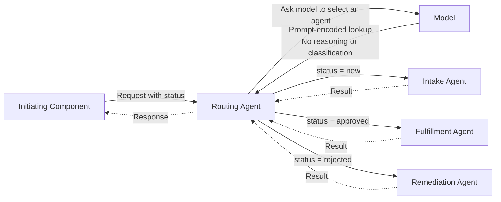
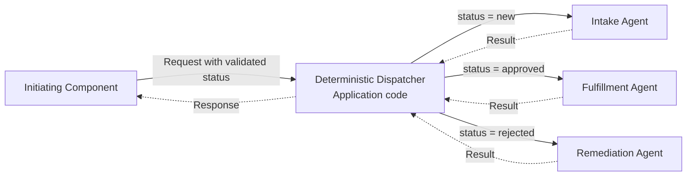

# Deterministic Multi-Agent Routing

## Anti-Pattern

An orchestrating agent receives structured input and selects another agent using a fixed mapping from an existing status, type, or other discrete field. The routing decision does not depend on semantic interpretation, incomplete information, conversation context, or any behavior that requires a language model.



The downstream agents may perform work that genuinely benefits from a model. The anti-pattern is the additional routing agent whose only responsibility is to reproduce a deterministic lookup that ordinary application code can perform.

## Issue

The routing agent adds an inference request, prompt tokens, orchestration latency, and another service dependency before useful work begins. Because the expected route is already encoded in structured state, none of this cost produces a better decision.

Replacing a deterministic branch with model output also weakens correctness. A model can select an invalid destination, ignore a status, invent an agent name, or produce inconsistent routes for identical inputs. Changes to prompts or models can alter behavior that should remain a stable application contract.

The extra agent complicates authorization, telemetry, retries, and failure handling. Operators must distinguish routing-model failures from downstream-agent failures, even though the routing decision could have been observable and testable as a small function.

This behavior is an anti-pattern only when the route is completely determined by validated structured input. A routing agent can be appropriate when it must infer intent from unstructured language, reconcile conflicting signals, discover capabilities dynamically, consider conversational context, or explain an uncertain decision. Keep those semantic decisions separate from deterministic state transitions.

## Implementation

[Microsoft Agent Framework](https://learn.microsoft.com/en-us/agent-framework/overview/) provides [handoff orchestration](https://learn.microsoft.com/en-us/agent-framework/workflows/orchestrations/handoff) for agents that transfer control based on conversation context. The following Python example misuses that capability: the starting agent asks a model to reproduce a fixed status lookup before handing work to a specialist.

The example uses a [`FoundryChatClient`](https://learn.microsoft.com/en-us/agent-framework/get-started/add-tools) authenticated by `AzureCliCredential`. The initiating component supplies JSON containing a validated `status` field.

!!! warning "Anti-pattern: Do not adopt"

    This implementation must not be adopted. The routing agent invokes a model even though the input status completely determines the downstream agent.

=== "Python"

    ```python
    import os

    from agent_framework import Agent
    from agent_framework.foundry import FoundryChatClient
    from agent_framework.orchestrations import HandoffBuilder
    from azure.identity import AzureCliCredential

    client = FoundryChatClient(
        project_endpoint=os.environ["FOUNDRY_PROJECT_ENDPOINT"],
        model=os.environ["FOUNDRY_MODEL_DEPLOYMENT_NAME"],
        credential=AzureCliCredential(),
    )

    routing_agent = Agent(
        client=client,
        name="routing_agent",
        instructions=(
            "The input is JSON with a status field. "
            "If status is new, hand off to intake_agent. "
            "If status is approved, hand off to fulfillment_agent. "
            "If status is rejected, hand off to remediation_agent. "
            "Do not perform any other work."
        ),
    )

    intake_agent = Agent(
        client=client,
        name="intake_agent",
        instructions="Validate and enrich new work items.",
    )
    fulfillment_agent = Agent(
        client=client,
        name="fulfillment_agent",
        instructions="Fulfill approved work items.",
    )
    remediation_agent = Agent(
        client=client,
        name="remediation_agent",
        instructions="Recommend corrections for rejected work items.",
    )

    workflow = (
        HandoffBuilder(
            name="status_routing_workflow",
            participants=[
                routing_agent,
                intake_agent,
                fulfillment_agent,
                remediation_agent,
            ],
        )
        .with_start_agent(routing_agent)
        .build()
    )
    ```

=== "TypeScript"

    ```typescript
    const routingAgent = createAgent({
      name: "routing_agent",
      instructions: `
        The input is JSON with a status field.
        If status is new, hand off to intake_agent.
        If status is approved, hand off to fulfillment_agent.
        If status is rejected, hand off to remediation_agent.
        Do not perform any other work.
      `,
    });

    const intakeAgent = createAgent({
      name: "intake_agent",
      instructions: "Validate and enrich new work items.",
    });
    const fulfillmentAgent = createAgent({
      name: "fulfillment_agent",
      instructions: "Fulfill approved work items.",
    });
    const remediationAgent = createAgent({
      name: "remediation_agent",
      instructions: "Recommend corrections for rejected work items.",
    });

    const workflow = createHandoffWorkflow({
      name: "status_routing_workflow",
      participants: [
        routingAgent,
        intakeAgent,
        fulfillmentAgent,
        remediationAgent,
      ],
      startAgent: routingAgent,
    });
    ```

Agent Framework handoffs are intended for context-dependent transfers of control. In this example, the routing prompt encodes an ordinary lookup table, so the first model invocation cannot improve the route.

## Recommended Approach

Place deterministic dispatch in an application component that validates the status against a closed set of supported values and selects the corresponding specialist from an explicit, typed mapping. The component should reject unsupported statuses before dispatch, invoke the selected specialist directly, and return its result without asking a model to make the routing decision. A specialist can still use a model when its own work requires semantic reasoning.



Retain the specialist agents and replace the routing agent with typed application code:

=== "Python"

    ```python
    import json
    from dataclasses import asdict, dataclass
    from enum import StrEnum


    class WorkItemStatus(StrEnum):
        NEW = "new"
        APPROVED = "approved"
        REJECTED = "rejected"


    @dataclass(frozen=True)
    class WorkItem:
        work_item_id: str
        status: WorkItemStatus
        details: str


    AGENT_BY_STATUS = {
        WorkItemStatus.NEW: intake_agent,
        WorkItemStatus.APPROVED: fulfillment_agent,
        WorkItemStatus.REJECTED: remediation_agent,
    }


    async def dispatch(item: WorkItem):
        agent = AGENT_BY_STATUS[item.status]
        return await agent.run(json.dumps(asdict(item)))
    ```

=== "TypeScript"

    ```typescript
    type WorkItemStatus = "new" | "approved" | "rejected";

    interface WorkItem {
      workItemId: string;
      status: WorkItemStatus;
      details: string;
    }

    const agentByStatus = {
      new: intakeAgent,
      approved: fulfillmentAgent,
      rejected: remediationAgent,
    } satisfies Record<WorkItemStatus, typeof intakeAgent>;

    async function dispatch(item: WorkItem) {
      const agent = agentByStatus[item.status];
      return agent.run(JSON.stringify(item));
    }
    ```

The replacement makes routing deterministic, testable, and independent of model behavior. Invalid statuses should fail during input validation rather than being interpreted by a model. The selected specialist can still use a model for the work that requires one.

For more complex deterministic flows, use normal workflow control structures, a rules engine, or explicit [Agent Framework workflow](https://learn.microsoft.com/en-us/agent-framework/workflows/) edges. Introduce a routing agent only at the boundary where semantic judgment begins.

## References

- [Microsoft Agent Framework overview](https://learn.microsoft.com/en-us/agent-framework/overview/)
- [Workflow orchestrations in Microsoft Agent Framework](https://learn.microsoft.com/en-us/agent-framework/workflows/orchestrations/)
- [Handoff orchestration — Microsoft Agent Framework](https://learn.microsoft.com/en-us/agent-framework/workflows/orchestrations/handoff)
- [Workflow capabilities — Microsoft Agent Framework](https://learn.microsoft.com/en-us/agent-framework/workflows/)
- [Add tools — Microsoft Agent Framework](https://learn.microsoft.com/en-us/agent-framework/get-started/add-tools)
- [Handoff orchestration Python sample — Microsoft Agent Framework](https://github.com/microsoft/agent-framework/blob/main/python/samples/03-workflows/orchestrations/handoff_simple.py)
