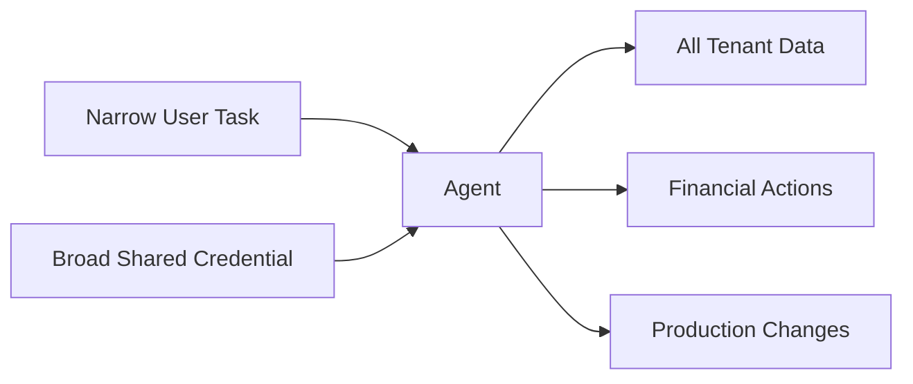

# Excessive Agency

## Anti-Pattern

An agent receives standing credentials, broad resource access, unrelated tools, or permission to execute high-impact actions without task-specific limits. Its maximum authority is defined by what the deployment identity can do rather than what the current user and task require.



The agent may use only a fraction of this authority during normal operation, but prompt injection, model error, compromised memory, or faulty orchestration can activate any exposed capability.

## Issue

Excessive agency converts a reasoning error into a security incident with a large blast radius. A manipulated support agent might export other tenants' records, a coding agent might deploy to production, or a finance agent might issue a payment larger than the initiating actor can authorize.

Broad shared credentials also destroy accountability. Downstream logs identify the common service principal rather than the initiating actor, agent instance, task, and approval that caused the action. Long-lived grants remain useful after the task ends and can accumulate as new tools are added.

For example, using one Microsoft Foundry project managed identity for several agents with different responsibilities makes the project identity their shared authorization boundary. A permission added for one agent becomes available to every agent that can use that identity. A project identity can be appropriate when all participating agents intentionally share the same trust and permission boundary; it should not substitute for agent-specific identity when their authority differs.

Static prompt restrictions do not reduce actual authority. Instructions such as "never call the admin tool" are behavioral guidance, not an access-control boundary. Hiding a tool from its description while leaving it callable has the same defect.

## Implementation

[Microsoft Agent Framework](https://learn.microsoft.com/en-us/agent-framework/overview/) can register functions as agent tools. The following implementation is intentionally unsafe and must not be adopted: every run receives every tool backed by one broadly privileged credential.

!!! warning "Anti-pattern: Do not adopt"

    This implementation exposes unrelated capabilities and relies on the model to stay within task scope.

=== "Python"

    ```python
    admin_credential = load_long_lived_admin_credential()

    all_tools = [
        create_customer_lookup_tool(admin_credential),
        create_tenant_export_tool(admin_credential),
        create_refund_tool(admin_credential),
        create_production_deployment_tool(admin_credential),
        create_role_assignment_tool(admin_credential),
    ]

    agent = create_agent(
        instructions=(
            "Help with customer support. "
            "Only use powerful tools when absolutely necessary."
        ),
        tools=all_tools,
    )

    await agent.run(user_request)
    ```

=== "TypeScript"

    ```typescript
    const adminCredential = loadLongLivedAdminCredential();

    const allTools = [
      createCustomerLookupTool(adminCredential),
      createTenantExportTool(adminCredential),
      createRefundTool(adminCredential),
      createProductionDeploymentTool(adminCredential),
      createRoleAssignmentTool(adminCredential),
    ];

    const agent = createAgent({
      instructions: `
        Help with customer support.
        Only use powerful tools when absolutely necessary.
      `,
      tools: allTools,
    });

    await agent.run(userRequest);
    ```

The prompt does not constrain the credential, tenant, resource, amount, environment, or duration. A newly added tool silently expands every run's authority.

## Recommended Approach

Adopt [Task-Scoped Agent Authority](../patterns/task-scoped-agent-authority.md). Construct a closed authority envelope from authenticated task data, register only the required tools, acquire narrowly scoped and short-lived credentials, and authorize every invocation against the initiating actor.

=== "Python"

    ```python
    from datetime import UTC, datetime, timedelta

    authority = await authority_policy.create(
        actor_id=authenticated_user.id,
        tenant_id=authenticated_user.tenant_id,
        task_kind="case-review",
        case_id=request.case_id,
        expires_at=datetime.now(UTC) + timedelta(minutes=15),
    )

    tools = build_scoped_tools(authority, tool_registry)
    credential = await token_broker.acquire(
        agent_identity_id=authority.agent_identity_id,
        audience="customer-case-api",
        scopes=["case.read", "response.draft"],
        expires_at=authority.expires_at,
    )

    agent = create_agent(tools=tools, credential=credential)
    await agent.run(request.prompt)
    ```

=== "TypeScript"

    ```typescript
    const authority = await authorityPolicy.create({
      actorId: authenticatedUser.id,
      tenantId: authenticatedUser.tenantId,
      taskKind: "case-review",
      caseId: request.caseId,
      expiresAt: new Date(Date.now() + 15 * 60_000),
    });

    const tools = buildScopedTools(authority, toolRegistry);
    const credential = await tokenBroker.acquire({
      agentIdentityId: authority.agentIdentityId,
      audience: "customer-case-api",
      scopes: ["case.read", "response.draft"],
      expiresAt: authority.expiresAt,
    });

    const agent = createAgent({ tools, credential });
    await agent.run(request.prompt);
    ```

Use an independently attributable identity for each logical agent whose permissions or lifecycle must be governed separately. Viable approaches include:

- [Microsoft Agent 365 identity](https://learn.microsoft.com/en-us/microsoft-agent-365/developer/identity), which uses Microsoft Entra Agent ID to represent each agent with a distinct identity and adds centralized inventory, sponsorship, governance, and security controls.
- [Microsoft Foundry agent identities](https://learn.microsoft.com/en-us/azure/foundry/agents/concepts/agent-identity), which provision distinct Entra agent identities and acquire downstream tokens for those identities instead of requiring every agent to act as the Foundry project managed identity.
- Direct [Microsoft Entra Agent ID architecture](https://learn.microsoft.com/en-us/entra/agent-id/how-to-plan-agent-identity-architecture) for agents hosted outside those control planes. Its default guidance is one identity per logical agent, with blueprints separated by credential and trust boundary.
- A dedicated managed or workload identity when agent-specific identity facilities are unavailable, or an on-behalf-of flow when an interactive agent must act within the signed-in user's delegated authority.

Choose the identity platform that fits the hosting and governance environment, but do not collapse independently governed agents into one shared principal merely for deployment convenience. [Azure RBAC best practices](https://learn.microsoft.com/en-us/azure/role-based-access-control/best-practices) recommend narrow roles and scopes, explicit actions instead of wildcards, and time-bound privileged access.

Require [Human-in-the-Loop Tool Approval Gate](../patterns/human-in-the-loop-tool-approval-gate.md) for high-impact actions even when they are inside the task envelope. Preserve an audit chain from user to agent identity, authority grant, tool call, approval, downstream identity, and result.

## References

- [Microsoft Agent Framework overview](https://learn.microsoft.com/en-us/agent-framework/overview/)
- [Agent 365 identity](https://learn.microsoft.com/en-us/microsoft-agent-365/developer/identity)
- [Agent identity concepts in Microsoft Foundry](https://learn.microsoft.com/en-us/azure/foundry/agents/concepts/agent-identity)
- [Plan your agent identity architecture — Microsoft Entra Agent ID](https://learn.microsoft.com/en-us/entra/agent-id/how-to-plan-agent-identity-architecture)
- [Best practices for Azure RBAC](https://learn.microsoft.com/en-us/azure/role-based-access-control/best-practices)
- [OWASP Top 10 for Agentic Applications 2026](https://genai.owasp.org/resource/owasp-top-10-for-agentic-applications-for-2026/)
