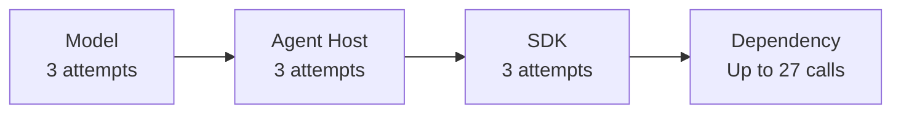

# Retry Policy Stacking

## Anti-Pattern

The model, agent host, application client, SDK, gateway, and worker each retry the same logical tool action independently. Every layer has a local limit, but no layer knows the total number of downstream attempts or shares one deadline and retry budget.



A configuration that appears bounded at each layer can multiply into a large retry tree. The multiplication is especially dangerous when retries trigger new model turns or when some layers retry after an ambiguous timeout.

## Issue

Stacked retries increase latency, token use, quota consumption, and load on an already unhealthy dependency. Many clients retrying through several layers can create a retry storm that delays recovery.

Telemetry becomes misleading because each layer reports only its own attempts. An agent trace might show three tool calls while the dependency receives dozens of requests. Local backoff also fails to coordinate the overall deadline; an inner layer can consume the time an outer layer expected to reserve for fallback or user feedback.

For side-effecting tools, an acknowledged response can be lost after the operation succeeds. Another layer then repeats the logical action and can create duplicate payments, messages, or writes unless the action is idempotent.

## Implementation

The following implementation is intentionally unreliable and must not be adopted. The agent loop, wrapper, and service client each retry three times.

!!! warning "Anti-pattern: Do not adopt"

    This implementation can turn one operation into 27 dependency calls and hides the true attempt count.

```typescript
async function modelDrivenToolCall(input: RefundInput): Promise<Refund> {
  return retry(3, () =>
    agentToolWrapper(input),
  );
}

async function agentToolWrapper(input: RefundInput): Promise<Refund> {
  return retry(3, () =>
    paymentClient.refund(input),
  );
}

const paymentClient = createPaymentClient({
  maxRetries: 3,
});
```

The model may add further attempts after seeing an error, and infrastructure outside this process may retry again. None of the layers propagates an operation ID, attempt count, deadline, or remaining budget.

## Recommended Approach

Inventory every retrying layer and designate one owner for retries of a logical operation. Disable redundant policies where practical. Pass a stable operation ID, absolute deadline, and shared attempt budget through the complete call chain.

```typescript
interface RetryContext {
  operationId: string;
  deadlineMs: number;
  attemptsRemaining: number;
}

async function executeWithRetryBudget<T>(
  context: RetryContext,
  operation: (attempt: number) => Promise<T>,
): Promise<T> {
  let attempt = 0;

  while (context.attemptsRemaining > 0) {
    if (Date.now() >= context.deadlineMs) {
      throw new Error("Retry deadline exhausted.");
    }

    context.attemptsRemaining -= 1;
    attempt += 1;

    try {
      return await operation(attempt);
    } catch (error) {
      if (!isTransient(error) || context.attemptsRemaining === 0) {
        throw error;
      }
      await delay(backoffWithJitter(attempt, context.deadlineMs));
    }
  }

  throw new Error("Retry budget exhausted.");
}
```

The [Azure Architecture Center Retry pattern](https://learn.microsoft.com/en-us/azure/architecture/patterns/retry) recommends retrying only transient faults, limiting attempts and duration, and using increasing delays. The [Retry Storm antipattern](https://learn.microsoft.com/en-us/azure/architecture/antipatterns/retry-storm/) adds server signals, telemetry, and circuit breaking to prevent retries from intensifying an outage.

Count every physical attempt in telemetry even when an SDK performs it. Honor dependency retry guidance and `Retry-After` signals. Stop when [Tool Call Circuit Breaker](../patterns/tool-call-circuit-breaker.md) reports an open circuit, and include all model-requested repeats in [Bounded Tool Calls](../patterns/bounded-tool-calls.md).

Make side-effecting operations follow [Idempotent Tool Actions](../patterns/idempotent-tool-actions.md). A retry budget decides whether another attempt is allowed; idempotency ensures a permitted retry cannot repeat the logical effect.

## References

- [Retry pattern — Azure Architecture Center](https://learn.microsoft.com/en-us/azure/architecture/patterns/retry)
- [Retry Storm antipattern — Azure Architecture Center](https://learn.microsoft.com/en-us/azure/architecture/antipatterns/retry-storm/)
- [Circuit Breaker pattern — Azure Architecture Center](https://learn.microsoft.com/en-us/azure/architecture/patterns/circuit-breaker)
