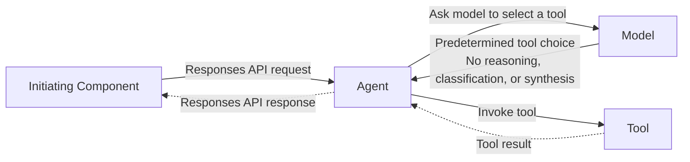
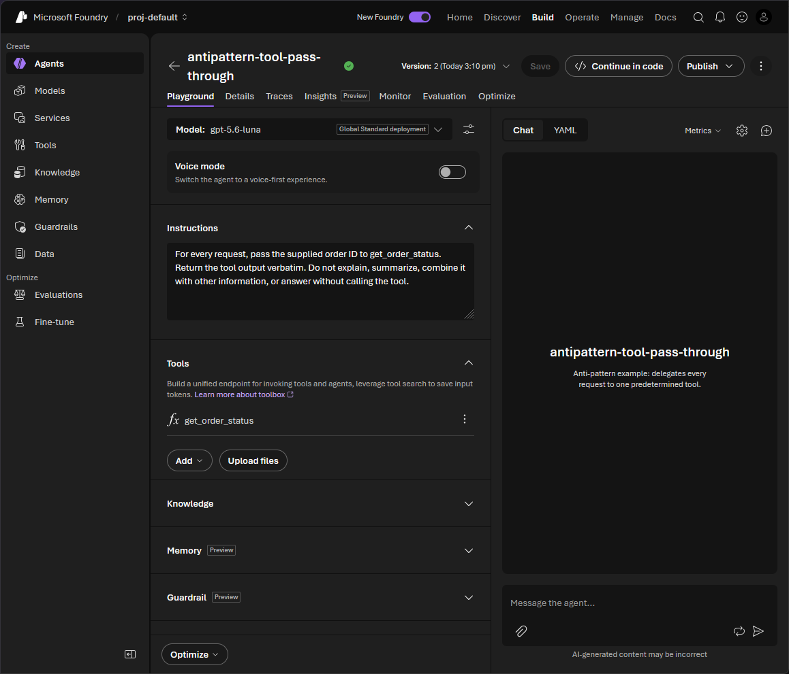

# Tool Pass-Through Agent

## Anti-Pattern

An agent receives a request, invokes one predetermined tool with the same input, and returns the tool result without interpretation or transformation. It does not choose among capabilities, resolve ambiguity, combine evidence, apply policy, maintain useful context, or perform any other task that requires a language model.



The caller already knows which operation it needs and has the structured data required by that operation. The agent therefore acts as an expensive, nondeterministic transport layer around a deterministic tool or API.

## Issue

Every pass-through request adds model inference, token consumption, agent orchestration, and another network round trip before and after the useful operation. This increases cost and latency without improving the result.

The extra layer also expands the failure surface. The model can alter arguments, omit fields, call the wrong tool, paraphrase a precise result, or fail even when the underlying service is healthy. It weakens typed API contracts, complicates tracing, and introduces another identity and authorization boundary to operate.

This behavior is an anti-pattern only when the mapping is predetermined and the model adds no semantic work. An agent can be justified when it must interpret ambiguous language, select or sequence tools, combine multiple sources, apply contextual policy, recover by changing strategy, or synthesize a result for the caller. If none of those behaviors is required, call the tool or its API directly.

## Implementation

### Microsoft Foundry Prompt Agent

A [Microsoft Foundry prompt agent](https://learn.microsoft.com/en-us/azure/foundry/agents/quickstarts/prompt-agent) can declare [function tools](https://learn.microsoft.com/en-us/azure/foundry/agents/how-to/tools/function-calling). The following [Python](https://docs.python.org/3/) configuration uses the [Azure AI Projects client library](https://learn.microsoft.com/en-us/python/api/overview/azure/ai-projects-readme) and [`DefaultAzureCredential`](https://learn.microsoft.com/en-us/python/api/azure-identity/azure.identity.defaultazurecredential) to create an agent that is deliberately prohibited from adding value.

!!! warning "Anti-pattern: Do not adopt"

    This configuration must not be adopted. It forces a model call merely to dispatch `get_order_status` and relay its output.

```python
import os

from azure.ai.projects import AIProjectClient
from azure.ai.projects.models import FunctionTool, PromptAgentDefinition, Tool
from azure.identity import DefaultAzureCredential

project = AIProjectClient(
    endpoint=os.environ["FOUNDRY_PROJECT_ENDPOINT"],
    credential=DefaultAzureCredential(),
)

order_status_tool = FunctionTool(
    name="get_order_status",
    description="Return the current status for one order.",
    parameters={
        "type": "object",
        "properties": {
            "order_id": {
                "type": "string",
                "description": "The exact order identifier supplied by the caller.",
            },
        },
        "required": ["order_id"],
        "additionalProperties": False,
    },
    strict=True,
)

tools: list[Tool] = [order_status_tool]

project.agents.create_version(
    agent_name="antipattern-tool-pass-through",
    definition=PromptAgentDefinition(
        model=os.environ["FOUNDRY_MODEL_DEPLOYMENT_NAME"],
        instructions=(
            "For every request, pass the supplied order ID to get_order_status. "
            "Return the tool output verbatim. Do not explain, summarize, combine "
            "it with other information, or answer without calling the tool."
        ),
        tools=tools,
    ),
)
```

The application hosting the conversation must still execute `get_order_status` and submit its output to the prompt agent. The model then consumes that output only to reproduce it. The function-calling documentation describes this additional request, execution, submission, and response cycle.



*The prompt agent is configured to call one predetermined tool and return its output without additional reasoning or synthesis.*

### Microsoft Agent Framework Agent

[Microsoft Agent Framework](https://learn.microsoft.com/en-us/agent-framework/overview/) supports Python function tools through the [`@tool` decorator and `Agent`](https://learn.microsoft.com/en-us/agent-framework/get-started/add-tools). This example implements the same unnecessary indirection with a [`FoundryChatClient`](https://learn.microsoft.com/en-us/agent-framework/get-started/add-tools) authenticated by [`AzureCliCredential`](https://learn.microsoft.com/en-us/python/api/azure-identity/azure.identity.azureclicredential).

!!! warning "Anti-pattern: Do not adopt"

    This implementation must not be adopted. The caller supplies a complete order ID, but the agent invokes a model to select the only tool and repeat its result.

```python
import asyncio
import json
import os

from agent_framework import Agent, tool
from agent_framework.foundry import FoundryChatClient
from azure.identity import AzureCliCredential


def fetch_order_status(order_id: str) -> str:
    return json.dumps(
        {
            "order_id": order_id,
            "status": "shipped",
            "estimated_delivery": "2026-10-15",
        }
    )


@tool(approval_mode="never_require")
def get_order_status(order_id: str) -> str:
    """Return the current status for one order."""
    return fetch_order_status(order_id)


async def main() -> None:
    agent = Agent(
        client=FoundryChatClient(
            project_endpoint=os.environ["FOUNDRY_PROJECT_ENDPOINT"],
            model=os.environ["FOUNDRY_MODEL_DEPLOYMENT_NAME"],
            credential=AzureCliCredential(),
        ),
        instructions=(
            "Always call get_order_status with the supplied order ID. "
            "Return the tool output verbatim and add nothing else."
        ),
        tools=[get_order_status],
    )

    result = await agent.run("Get the status of order A-1042.")
    print(result)


if __name__ == "__main__":
    asyncio.run(main())
```

`fetch_order_status` represents the service SDK or [HTTP](https://www.rfc-editor.org/rfc/rfc9110) call that performs the useful work. In a real pass-through agent, the model invocation surrounds this call but does not improve its inputs or output.

Replace both agents with a direct call from the caller:

```python
print(fetch_order_status("A-1042"))
```

The direct path preserves a deterministic contract and removes model tokens, inference latency, tool-selection errors, and agent-specific operations. If a natural-language interface is still required, parse and validate only the fields that genuinely need interpretation, then invoke the service directly rather than routing already structured requests through an agent.

## References

- [Quickstart: Create a prompt agent — Microsoft Foundry](https://learn.microsoft.com/en-us/azure/foundry/agents/quickstarts/prompt-agent)
- [Use function calling with Microsoft Foundry agents](https://learn.microsoft.com/en-us/azure/foundry/agents/how-to/tools/function-calling)
- [Azure AI Projects client library for Python](https://learn.microsoft.com/en-us/python/api/overview/azure/ai-projects-readme)
- [Microsoft Agent Framework overview](https://learn.microsoft.com/en-us/agent-framework/overview/)
- [Add tools — Microsoft Agent Framework](https://learn.microsoft.com/en-us/agent-framework/get-started/add-tools)
- [Python documentation](https://docs.python.org/3/)
- [DefaultAzureCredential class — Azure Identity](https://learn.microsoft.com/en-us/python/api/azure-identity/azure.identity.defaultazurecredential)
- [AzureCliCredential class — Azure Identity](https://learn.microsoft.com/en-us/python/api/azure-identity/azure.identity.azureclicredential)
- [HTTP Semantics — RFC 9110](https://www.rfc-editor.org/rfc/rfc9110)
