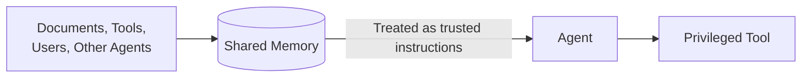

# Unvalidated Context and Memory Injection

## Anti-Pattern

An application inserts retrieved documents, tool output, user-authored notes, or another agent's messages directly into privileged context or persistent memory without recording provenance, enforcing tenant access, classifying trust, or distinguishing data from instructions.



Content that was safe to display or summarize becomes an implicit control channel. If persisted, one malicious or incorrect item can influence later runs and different users long after the original interaction.

## Issue

Indirect prompt injection can enter through files, webpages, email, search results, or tool output. When the application flattens those sources into the same instruction stream as trusted policy, the model cannot reliably enforce the intended boundary.

Persistent memory increases the impact. Poisoned instructions, false facts, or unsafe preferences can survive restarts, contaminate summaries, propagate to other agents, and become difficult to trace to their source. A shared retrieval index without tenant or document-level filtering can also disclose data before the model has any chance to respond safely.

Content filtering alone is insufficient. A benign-looking but unauthorized record is still a security failure, and a permitted document can contain untrusted instructions that must remain data.

## Implementation

The following implementation is intentionally unsafe and must not be adopted. It retrieves arbitrary text, stores it without metadata, and concatenates it into the agent's instructions.

!!! warning "Anti-pattern: Do not adopt"

    This implementation erases provenance and turns untrusted retrieved text into persistent instruction.

```typescript
async function learnFromSearch(query: string): Promise<void> {
  const documents = await searchClient.search(query);

  for (const document of documents) {
    await memory.append(document.text);
  }
}

async function runAgent(request: string): Promise<string> {
  const remembered = await memory.readAll();
  return agent.run(`
    Follow these remembered instructions and facts:
    ${remembered.join("\n")}

    User request:
    ${request}
  `);
}
```

The code does not preserve source identity, tenant, authorization, trust level, content role, version, or write actor. Any retrieved passage can become a durable instruction for any later run.

## Recommended Approach

Keep trusted instructions outside retrieved content. Store memory as typed records with immutable provenance, ownership, purpose, trust classification, version, and expiry. Enforce authorization on both writes and reads, and default retrieved content to untrusted data.

[OWASP ASI06: Memory & Context Poisoning](https://genai.owasp.org/2026/05/13/memory-is-a-feature-it-is-also-an-attack-surface/) identifies persistence as the defining risk: attacker-controlled content can remain in memory, hooks, configuration, or other trusted state and influence future reasoning and actions. Treat every path that promotes content into reusable context as a security boundary.

```typescript
interface MemoryRecord {
  id: string;
  tenantId: string;
  subjectId: string;
  sourceUri: string;
  sourceVersion: string;
  writtenBy: string;
  content: string;
  role: "reference-data" | "user-preference" | "verified-fact";
  trust: "untrusted" | "verified";
  expiresAt: Date;
}

async function loadContext(
  authority: TaskAuthority,
  query: string,
): Promise<MemoryRecord[]> {
  const records = await memory.search({
    tenantId: authority.tenantId,
    subjectId: authority.caseId,
    query,
  });

  return records.filter(
    (record) =>
      record.expiresAt.getTime() > Date.now() &&
      memoryPolicy.mayRead(authority, record),
  );
}
```

Render retrieved records in a clearly delimited data section that states they may contain untrusted instructions. Only a separate, authorized verification process may promote content to `verified`, and promotion must create a new auditable version rather than overwrite provenance.

Use [Azure AI Search document-level access control](https://learn.microsoft.com/en-us/azure/search/search-document-level-access-overview) or equivalent security trimming before retrieved text reaches the agent. Apply [Prompt Shields in Azure AI Content Safety](https://learn.microsoft.com/en-us/azure/ai-services/content-safety/concepts/jailbreak-detection) as defense in depth for attacks embedded in user prompts and documents, but do not treat detection as a substitute for authorization or provenance.

Log memory writes, promotions, reads, and deletions with record identifiers rather than copying sensitive content into telemetry. Support expiry, rollback, quarantine, and incident-driven invalidation. Reauthorize any tool action influenced by retrieved data at the action boundary.

## References

- [Document-Level Access Control — Azure AI Search](https://learn.microsoft.com/en-us/azure/search/search-document-level-access-overview)
- [Prompt Shields in Azure AI Content Safety](https://learn.microsoft.com/en-us/azure/ai-services/content-safety/concepts/jailbreak-detection)
- [Memory Is a Feature. It Is Also an Attack Surface — OWASP ASI06: Memory & Context Poisoning](https://genai.owasp.org/2026/05/13/memory-is-a-feature-it-is-also-an-attack-surface/)
