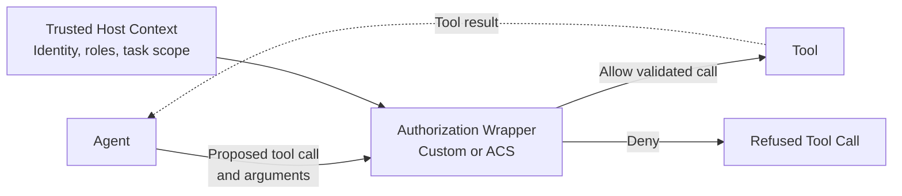

# Contextual Tool Authorization

## Pattern

Authorize each proposed tool call immediately before execution by evaluating the tool, its arguments, and trusted context for the current agent run. Execute the tool only when that combined context satisfies policy.

The authorization context can include the actor's roles, tenant, task scope, prior actions, data classifications, approval state, and destination. The host must supply trusted attributes independently of model-generated arguments and enforce the decision at the shared tool-dispatch boundary. A model instruction or static tool allowlist is not sufficient because permission to use a tool does not imply permission to perform every action that tool supports.



The wrapper is the policy enforcement point for every invocation. It prevents denied calls from reaching the tool and passes only authorized, validated arguments when the call is allowed.

Unlike [Bounded Tool Calls](bounded-tool-calls.md), which limits call volume, or [Tool Call Circuit Breaker](tool-call-circuit-breaker.md), which responds to dependency health, this pattern decides whether the specific proposed action is permitted.

## Applicability

Use this pattern when a tool can access protected data or create side effects and authorization depends on more than the tool name. It is especially useful when:

- One tool serves actors, tenants, resources, or destinations with different permissions.
- An action is allowed only within the task or case assigned to the current user.
- Tool arguments can change the risk, such as an email recipient, payment amount, file path, or deployment environment.
- Earlier events in the run can narrow what the agent may do.
- Multiple agent frameworks must enforce the same centrally managed policy.

Keep coarse identity and access controls on the underlying service. Contextual tool authorization is an additional check at the agent boundary, not a replacement for service-side authorization, least-privilege credentials, validation, sandboxing, or human approval for actions that require it.

## Implementation

### Introduction

The following example guards a `send_email` tool. A support agent may send only to the organization's domain and only for the case assigned to the current session. The host, not the model, supplies the actor and assigned case.

### Custom Tool Wrapper

A custom wrapper can enforce contextual authorization directly at the tool boundary. This approach is useful when one application owns a small, stable policy surface and does not need a portable policy manifest or shared policy runtime.

The wrappers accept authorization context from the trusted host and close over it when constructing the tool handler. The model can propose email arguments, but it cannot choose its roles or assigned case:

=== "Python"

    ```python
    from collections.abc import Awaitable, Callable, Mapping
    from dataclasses import dataclass
    from typing import Any, TypedDict, TypeGuard


    @dataclass(frozen=True)
    class Actor:
        id: str
        roles: tuple[str, ...]


    @dataclass(frozen=True)
    class AuthorizationContext:
        actor: Actor
        assigned_case_id: str


    class SendEmailArgs(TypedDict):
        to: str
        case_id: str
        subject: str
        body: str


    SendEmailTool = Callable[[object], Awaitable[None]]


    class ToolAuthorizationDenied(Exception):
        def __init__(self, reason: str) -> None:
            self.reason = reason
            super().__init__(f"Tool authorization denied: {reason}")


    def is_send_email_args(value: object) -> TypeGuard[SendEmailArgs]:
        if not isinstance(value, Mapping):
            return False

        return all(
            isinstance(value.get(key), str)
            for key in ("to", "case_id", "subject", "body")
        )


    def create_authorized_send_email_tool(
        context: AuthorizationContext,
        send_email: Callable[[SendEmailArgs], Awaitable[None]],
    ) -> SendEmailTool:
        async def authorized_send_email(proposed_args: object) -> None:
            if not is_send_email_args(proposed_args):
                raise ToolAuthorizationDenied("invalid_arguments")

            separator = proposed_args["to"].rfind("@")
            recipient_domain = proposed_args["to"][separator + 1 :].lower()

            if "support-agent" not in context.actor.roles:
                raise ToolAuthorizationDenied("role_not_permitted")

            if separator < 1 or recipient_domain != "contoso.com":
                raise ToolAuthorizationDenied("external_recipient")

            if (
                proposed_args["case_id"] == ""
                or proposed_args["case_id"] != context.assigned_case_id
            ):
                raise ToolAuthorizationDenied("case_out_of_scope")

            await send_email(proposed_args)

        return authorized_send_email
    ```

=== "TypeScript"

    ```typescript
    interface Actor {
      id: string;
      roles: readonly string[];
    }

    interface AuthorizationContext {
      actor: Actor;
      assignedCaseId: string;
    }

    interface SendEmailArgs {
      to: string;
      case_id: string;
      subject: string;
      body: string;
    }

    type SendEmailTool = (args: unknown) => Promise<void>;

    class ToolAuthorizationDenied extends Error {
      constructor(readonly reason: string) {
        super(`Tool authorization denied: ${reason}`);
      }
    }

    function isSendEmailArgs(value: unknown): value is SendEmailArgs {
      if (typeof value !== "object" || value === null) {
        return false;
      }

      const args = value as Record<string, unknown>;
      return (
        typeof args.to === "string" &&
        typeof args.case_id === "string" &&
        typeof args.subject === "string" &&
        typeof args.body === "string"
      );
    }

    function createAuthorizedSendEmailTool(
      context: AuthorizationContext,
      sendEmail: (args: SendEmailArgs) => Promise<void>,
    ): SendEmailTool {
      return async (proposedArgs: unknown): Promise<void> => {
        if (!isSendEmailArgs(proposedArgs)) {
          throw new ToolAuthorizationDenied("invalid_arguments");
        }

        const separator = proposedArgs.to.lastIndexOf("@");
        const recipientDomain = proposedArgs.to
          .slice(separator + 1)
          .toLowerCase();

        if (!context.actor.roles.includes("support-agent")) {
          throw new ToolAuthorizationDenied("role_not_permitted");
        }

        if (separator < 1 || recipientDomain !== "contoso.com") {
          throw new ToolAuthorizationDenied("external_recipient");
        }

        if (
          proposedArgs.case_id === "" ||
          proposedArgs.case_id !== context.assignedCaseId
        ) {
          throw new ToolAuthorizationDenied("case_out_of_scope");
        }

        await sendEmail(proposedArgs);
      };
    }
    ```

Create the wrapped handler from authenticated host state, then expose only that handler to the agent:

=== "Python"

    ```python
    send_email_tool = create_authorized_send_email_tool(
        AuthorizationContext(
            actor=authenticated_actor,
            assigned_case_id=active_case.id,
        ),
        send_email,
    )
    ```

=== "TypeScript"

    ```typescript
    const sendEmailTool = createAuthorizedSendEmailTool(
      {
        actor: authenticatedActor,
        assignedCaseId: activeCase.id,
      },
      sendEmail,
    );
    ```

Every route to the underlying operation must pass through the wrapper. Keep `sendEmail` private to the tool integration module or enforce the same authorization in the downstream service so another caller cannot bypass the check. Report `ToolAuthorizationDenied` as a refused tool call; do not retry by invoking `sendEmail` directly.

This implementation keeps policy in application code. As rules expand across tools, applications, or agent frameworks, move the decision logic behind a dedicated authorization service or use a portable policy runtime while preserving the same pre-execution enforcement boundary.

### Agent Control Specification

The [Agent Control Specification (ACS)](https://github.com/responsibleai/agent-control-spec) is a stateless policy decision runtime that implements the [Agent Hooks](https://github.com/responsibleai/agent-hooks) interception contract. An agent host can evaluate an ACS policy at `pre_tool_call`, after the model proposes a concrete invocation but before the tool creates a side effect.

#### Bind policy to the tool boundary

An ACS manifest selects the tool arguments as the policy target and projects the current tool's metadata into the policy input:

```yaml
agent_control_specification_version: 0.4.0-alpha.1
metadata:
  name: support-email-authorization
policies:
  authorize_email:
    type: rego
    bundle: ./policy/authorize-email.rego
    query: data.support_email.verdict
intervention_points:
  pre_tool_call:
    policy_target: $.tool_call.args
    policy_target_kind: tool_args
    tool_name_from: $.tool_call.name
    policy:
      id: authorize_email
tools:
  send_email:
    type: Tool
    id: send_email
```

Pin the manifest version to one supported by the deployed ACS package and validate the manifest during deployment. Do not silently skip authorization when loading or activation fails.

#### Deny unless the complete context is authorized

The [Rego policy language](https://www.openpolicyagent.org/docs/policy-language) rule defaults to denial. It permits the call only when the host-supplied actor has the required role, the message stays inside the organization, and the proposed case ID matches the case assigned to the session:

```rego
package support_email

import rego.v1

default verdict := {
    "decision": "deny",
    "reason": "contextual_authorization_denied",
}

authorization := object.get(
    object.get(input.snapshot, "extensions", {}),
    "authorization",
    {},
)

actor := object.get(authorization, "actor", {})
roles := object.get(actor, "roles", [])
assigned_case_id := object.get(authorization, "assigned_case_id", "")
args := input.policy_target.value

verdict := {"decision": "allow"} if {
    input.intervention_point == "pre_tool_call"
    input.tool.id == "send_email"
    "support-agent" in roles
    is_string(args.to)
    endswith(args.to, "@contoso.com")
    is_string(args.case_id)
    args.case_id != ""
    args.case_id == assigned_case_id
}
```

Missing or malformed context cannot satisfy the allow rule. A production policy can return more specific denial reason codes, but those reasons must not disclose protected policy details to an untrusted caller.

#### Enforce the verdict in the host

Install the prerelease ACS and Agent Hooks packages at explicitly tested versions. The package documentation currently requires the `@alpha` distribution tag when selecting the current prerelease:

```shell
python -m pip install --pre agent-control-spec
npm install @responsibleai/agent-control-spec@alpha
```

The following wrappers create the policy interceptor once, add trusted authorization attributes to each Agent Hooks context, and invoke the tool only after `emit` permits the call:

=== "Python"

    ```python
    from collections.abc import Awaitable, Callable
    from uuid import uuid4

    from agent_control_spec import AcsInterceptor
    from agent_hooks import AgentContextBuilder, InterceptionEmitter

    emitter = InterceptionEmitter()
    emitter.register(
        AcsInterceptor("manifest.yaml"),
        "contextual-tool-authorization",
    )


    class AuthorizedToolDispatcher:
        def __init__(
            self,
            session_id: str,
            actor: Actor,
            assigned_case_id: str,
            send_email: Callable[[SendEmailArgs], Awaitable[None]],
        ) -> None:
            self._actor = actor
            self._assigned_case_id = assigned_case_id
            self._send_email = send_email
            self._context_builder = AgentContextBuilder(
                agent_id="support-agent",
                framework="microsoft-agent-framework",
                session_id=session_id,
            )

        async def dispatch_send_email(
            self,
            proposed_args: SendEmailArgs,
        ) -> None:
            context = self._context_builder.pre_tool_call(
                call_id=str(uuid4()),
                name="send_email",
                args=proposed_args,
            )
            context["extensions"] = {
                "authorization": {
                    "actor": {
                        "id": self._actor.id,
                        "roles": list(self._actor.roles),
                    },
                    "assigned_case_id": self._assigned_case_id,
                },
            }

            outcome = await emitter.emit(context)
            if not is_send_email_args(outcome.target):
                raise TypeError("Policy returned invalid send_email arguments.")

            await self._send_email(outcome.target)
    ```

=== "TypeScript"

    ```typescript
    import { randomUUID } from "node:crypto";

    import { AcsInterceptor } from "@responsibleai/agent-control-spec";
    import {
      AgentContextBuilder,
      InterceptionEmitter,
      type JsonValue,
    } from "@responsibleai/agent-hooks";

    interface Actor {
      id: string;
      roles: string[];
    }

    type SendEmailArgs = {
      to: string;
      case_id: string;
      subject: string;
      body: string;
    } & Record<string, JsonValue>;

    type ToolHandler = (args: SendEmailArgs) => Promise<void>;

    const emitter = new InterceptionEmitter();
    emitter.register(
      AcsInterceptor.fromPath("manifest.yaml"),
      "contextual-tool-authorization",
    );

    function isSendEmailArgs(value: unknown): value is SendEmailArgs {
      if (typeof value !== "object" || value === null) {
        return false;
      }

      const args = value as Record<string, unknown>;
      return (
        typeof args.to === "string" &&
        typeof args.case_id === "string" &&
        typeof args.subject === "string" &&
        typeof args.body === "string"
      );
    }

    class AuthorizedToolDispatcher {
      private readonly contextBuilder: AgentContextBuilder;

      constructor(
        sessionId: string,
        private readonly actor: Actor,
        private readonly assignedCaseId: string,
        private readonly sendEmail: ToolHandler,
      ) {
        this.contextBuilder = new AgentContextBuilder({
          agentId: "support-agent",
          framework: "microsoft-agent-framework",
          sessionId,
        });
      }

      async dispatchSendEmail(proposedArgs: SendEmailArgs): Promise<void> {
        const context = this.contextBuilder.preToolCall(
          randomUUID(),
          "send_email",
          proposedArgs,
        );

        context.extensions = {
          authorization: {
            actor: {
              id: this.actor.id,
              roles: this.actor.roles,
            },
            assigned_case_id: this.assignedCaseId,
          },
        };

        const outcome = await emitter.emit(context);
        if (!isSendEmailArgs(outcome.target)) {
          throw new TypeError("Policy returned invalid send_email arguments.");
        }

        await this.sendEmail(outcome.target);
      }
    }
    ```

`emit` throws when the combined verdict blocks execution, so the call to `sendEmail` is unreachable on denial or policy failure. The dispatcher also consumes `outcome.target` rather than the original arguments; this preserves the Agent Hooks contract if another registered control safely transforms the arguments.

Register the dispatcher beneath every route that can invoke the tool. For example, a [Microsoft Agent Framework](https://learn.microsoft.com/en-us/agent-framework/overview/) tool handler can delegate to `dispatchSendEmail`, while non-agent callers use the same guarded boundary. Do not place the check only in model instructions or one conversational path.

ACS is stateless. If policy depends on prior calls, accumulated data sensitivity, a budget, or an earlier approval, the host must maintain that state and include a complete trusted snapshot in every evaluation. The underlying email service must still authenticate the caller, validate the request, and enforce its own authorization.

## References

- [Agent Control Specification repository and runtime overview](https://github.com/responsibleai/agent-control-spec)
- [Agent Control Specification Python SDK](https://github.com/responsibleai/agent-control-spec/tree/main/sdk/python)
- [Agent Control Specification Node wrapper](https://github.com/responsibleai/agent-control-spec/tree/main/sdk/node)
- [Agent Control Specification package documentation - Microsoft Agent Governance Toolkit](https://github.com/microsoft/agent-governance-toolkit/blob/main/docs/packages/agent-control-specification.md)
- [Agent Hooks specification and SDK overview](https://github.com/responsibleai/agent-hooks)
- [Rego policy language - Open Policy Agent](https://www.openpolicyagent.org/docs/policy-language)
- [Microsoft Agent Framework overview](https://learn.microsoft.com/en-us/agent-framework/overview/)
