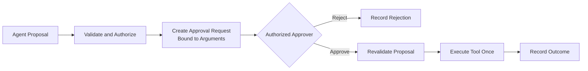

# Human-in-the-Loop Tool Approval Gate

## Pattern

Pause immediately before a privileged, irreversible, or high-impact tool action. Present an authorized approver with the exact validated operation, arguments, initiating identity, expected effect, and relevant risk context. Execute only after recording an explicit approval for that immutable proposal.



Approval is not a conversational suggestion. The host must enforce the pause outside the model, authenticate the approver, bind the decision to a digest or immutable identifier for the proposed arguments, and reject changed or expired requests. Revalidate authorization and preconditions immediately before execution.

## Applicability

Use an approval gate for actions such as:

- Payments, refunds, purchases, and financial commitments.
- Deletions, deployments, permission changes, and production mutations.
- External communications made on behalf of a person or organization.
- Disclosure or export of sensitive information.
- Actions whose impact exceeds a defined amount, environment, destination, or data-classification threshold.

Apply risk-based policy rather than requiring approval for every tool. Excessive low-value prompts train approvers to accept requests without inspection and remove useful autonomy. Conversely, do not let the model decide whether its own action needs approval; policy must classify the validated call.

Approval complements but does not replace [Contextual Tool Authorization](contextual-tool-authorization.md), least privilege, input validation, or [Idempotent Tool Actions](idempotent-tool-actions.md). Reusing an approval after a timeout must reuse the same operation ID so recovery cannot duplicate the side effect.

## Implementation

[Microsoft Agent Framework tool approval](https://learn.microsoft.com/en-us/agent-framework/agents/tools/tool-approval) marks selected functions with `approval_mode="always_require"`. When the agent proposes the tool, the framework returns a function approval request rather than executing it.

=== "Python"

    ```python
    from typing import Annotated

    from agent_framework import tool


    @tool(approval_mode="always_require")
    async def issue_refund(
        payment_id: Annotated[str, "Payment identifier"],
        amount_minor: Annotated[int, "Refund amount in minor currency units"],
        operation_id: Annotated[str, "Stable host-issued operation identifier"],
    ) -> str:
        return await payment_service.refund(
            payment_id=payment_id,
            amount_minor=amount_minor,
            operation_id=operation_id,
        )
    ```

=== "TypeScript"

    ```typescript
    interface RefundArguments {
      paymentId: string;
      amountMinor: number;
      operationId: string;
    }

    interface ApprovalRequiredTool<TArguments, TResult> {
      readonly approvalMode: "always_require";
      invoke(arguments_: TArguments): Promise<TResult>;
    }

    declare const paymentService: {
      refund(arguments_: RefundArguments): Promise<string>;
    };

    const issueRefund: ApprovalRequiredTool<RefundArguments, string> = {
      approvalMode: "always_require",
      async invoke(arguments_) {
        return paymentService.refund(arguments_);
      },
    };
    ```

The application handling the approval request must show the tool name and arguments, authenticate the approver, and record a decision before returning the framework's approval response:

=== "Python"

    ```python
    async def resolve_approval(agent, session, query, approval_service):
        result = await agent.run(query, session=session)

        while result.user_input_requests:
            responses = []
            for request in result.user_input_requests:
                proposal = {
                    "tool": request.function_call.name,
                    "arguments": request.function_call.arguments,
                }
                decision = await approval_service.decide(proposal)
                responses.append(
                    Message(
                        "user",
                        [request.to_function_approval_response(decision.approved)],
                    )
                )

            result = await agent.run(responses, session=session)

        return result
    ```

=== "TypeScript"

    ```typescript
    interface ApprovalRequest {
      functionCall: {
        name: string;
        arguments: unknown;
      };
      toFunctionApprovalResponse(approved: boolean): unknown;
    }

    interface AgentResult {
      userInputRequests: readonly ApprovalRequest[];
    }

    interface AgentSession {}

    interface Agent {
      run(
        input: string | readonly UserMessage[],
        options: { session: AgentSession },
      ): Promise<AgentResult>;
    }

    interface UserMessage {
      role: "user";
      contents: readonly unknown[];
    }

    interface ApprovalService {
      decide(proposal: {
        tool: string;
        arguments: unknown;
      }): Promise<{ approved: boolean }>;
    }

    async function resolveApproval(
      agent: Agent,
      session: AgentSession,
      query: string,
      approvalService: ApprovalService,
    ): Promise<AgentResult> {
      let result = await agent.run(query, { session });

      while (result.userInputRequests.length > 0) {
        const responses: UserMessage[] = [];
        for (const request of result.userInputRequests) {
          const proposal = {
            tool: request.functionCall.name,
            arguments: request.functionCall.arguments,
          };
          const decision = await approvalService.decide(proposal);
          responses.push({
            role: "user",
            contents: [
              request.toFunctionApprovalResponse(decision.approved),
            ],
          });
        }

        result = await agent.run(responses, { session });
      }

      return result;
    }
    ```

This focused example omits application-specific identity and persistence code. `approval_service.decide` must verify that the approver is permitted for the operation, record the proposal digest and decision, enforce expiry and separation-of-duties policy, and return rejection on any validation failure. Do not implement it as an unauthenticated terminal prompt in production.

For longer workflows, [Agent Framework human-in-the-loop workflows](https://learn.microsoft.com/en-us/agent-framework/workflows/human-in-the-loop) expose approval requests through the workflow request/response mechanism and resume the suspended run after a response. Persist the workflow checkpoint and approval record together so a restart cannot skip the gate.

After approval, compare the executable arguments with the approved proposal, recheck current policy, and execute through an idempotent tool boundary. Audit the initiating actor, agent, tool, proposal digest, approver, decision, timestamps, policy version, operation ID, and final outcome without copying unnecessary sensitive data.

## References

- [Function tools with human-in-the-loop approvals — Microsoft Agent Framework](https://learn.microsoft.com/en-us/agent-framework/agents/tools/tool-approval)
- [Human-in-the-loop workflows — Microsoft Agent Framework](https://learn.microsoft.com/en-us/agent-framework/workflows/human-in-the-loop)
