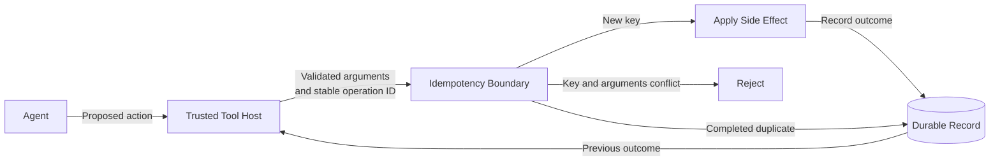

# Idempotent Tool Actions

## Pattern

Give every logical side-effecting tool action a stable idempotency key and enforce that key at the boundary where the side effect occurs. Reuse the same key when an agent retries after a timeout, resumes after approval, or recovers an interrupted run.

Bind the key to the validated action arguments. The first invocation atomically claims the key, performs the action, and records its outcome. A repeated invocation with the same key and arguments returns the recorded outcome or the current in-progress state instead of applying the side effect again. Reject the invocation if the same key is presented with different arguments.



The trusted host should create and retain the operation ID; do not ask the model to invent a new key for each attempt. Scope keys by tenant, tool, and operation so unrelated actions cannot suppress one another. Retain records for at least the longest interval in which the operation can be retried or resumed.

Unlike [Bounded Tool Calls](bounded-tool-calls.md), which limits aggregate tool use, this pattern makes a justified repeat safe. [Contextual Tool Authorization](contextual-tool-authorization.md) still decides whether each invocation is permitted, and [Tool Call Circuit Breaker](tool-call-circuit-breaker.md) still suppresses calls to an unhealthy dependency.

## Applicability

Use this pattern for tools that create externally visible or costly side effects, such as:

- Issuing a payment, refund, order, reservation, or deployment.
- Sending a message or submitting work to a queue.
- Creating or mutating a record where duplication would corrupt state.
- Resuming an action after human approval or an agent-process restart.
- Retrying after a timeout when the caller cannot determine whether the first attempt succeeded.

Prefer naturally idempotent operations where possible. Setting a resource to an absolute desired state is safer than applying a relative change, such as incrementing a balance. Read-only tools usually do not require idempotency records, although their consistency and cost may still need other controls.

Idempotency has a defined scope and retention period; it is not a permanent global guarantee. A key that expires too early can permit a delayed retry to repeat the action. A key that is reused too broadly can suppress a legitimate action. Size the retention interval from approval lifetime, workflow recovery time, queue delivery behavior, and downstream retry policies.

Authorize the current caller and validate the current request before returning a stored result. A prior successful action must not let a later unauthorized caller bypass policy or retrieve protected output.

## Implementation

The [Azure Architecture Center Idempotent Consumer pattern](https://learn.microsoft.com/en-us/azure/architecture/patterns/idempotent-consumer) recommends a stable logical-operation key, an atomic uniqueness constraint, and a durable record of the result. When the side effect and idempotency record use the same data store, commit them in one transaction. A separate check followed by a write leaves a crash window in which the effect succeeds but the key is never recorded.

For a side effect that cannot join the transaction, prefer a downstream API with native idempotency support and propagate the same key. Otherwise, claim the key as `in-progress`, execute the effect, and then record `completed` with the outcome. A stale `in-progress` record represents an uncertain result: reconcile it against the downstream system or route it for intervention rather than blindly repeating the action.

The following tool submits refund commands through [Azure Service Bus duplicate detection](https://learn.microsoft.com/en-us/azure/service-bus-messaging/duplicate-detection). The agent host creates one operation ID when it first accepts the action and persists the fingerprint of the validated arguments. Retries and approval resubmissions receive that same trusted context.

=== "Python"

    ```python
    import hashlib
    import json
    import os
    from dataclasses import dataclass
    from typing import Literal, TypedDict

    from azure.identity.aio import DefaultAzureCredential
    from azure.servicebus import ServiceBusMessage
    from azure.servicebus.aio import ServiceBusClient


    @dataclass(frozen=True)
    class RefundInput:
        case_id: str
        payment_id: str
        amount_minor: int
        currency: str


    @dataclass(frozen=True)
    class ToolExecutionContext:
        tenant_id: str
        operation_id: str
        approved_input_fingerprint: str


    class RefundAccepted(TypedDict):
        operation_id: str
        status: Literal["accepted"]


    class IdempotencyConflictError(Exception):
        pass


    credential = DefaultAzureCredential()
    service_bus = ServiceBusClient(
        fully_qualified_namespace=os.environ["SERVICE_BUS_NAMESPACE"],
        credential=credential,
    )
    sender = service_bus.get_queue_sender(queue_name="refund-commands")


    def hash_value(value: str) -> str:
        return hashlib.sha256(value.encode()).hexdigest()


    def fingerprint(input: RefundInput) -> str:
        return hash_value(json.dumps(
            [
                input.case_id,
                input.payment_id,
                input.amount_minor,
                input.currency,
            ],
            ensure_ascii=False,
            separators=(",", ":"),
        ))


    async def request_refund(
        input: RefundInput,
        context: ToolExecutionContext,
    ) -> RefundAccepted:
        input_fingerprint = fingerprint(input)

        if input_fingerprint != context.approved_input_fingerprint:
            raise IdempotencyConflictError(
                "The operation ID is already bound to different arguments."
            )

        message_id = hash_value("\0".join([
            context.tenant_id,
            "request_refund",
            context.operation_id,
        ]))

        body = json.dumps(
            {
                "caseId": input.case_id,
                "paymentId": input.payment_id,
                "amountMinor": input.amount_minor,
                "currency": input.currency,
                "operationId": context.operation_id,
                "tenantId": context.tenant_id,
            },
            ensure_ascii=False,
            separators=(",", ":"),
        )

        message = ServiceBusMessage(
            body=body,
            content_type="application/json",
            message_id=message_id,
            correlation_id=context.operation_id,
            application_properties={
                "inputFingerprint": input_fingerprint,
                "tenantId": context.tenant_id,
            },
        )

        await sender.send_messages(message)

        return {
            "operation_id": context.operation_id,
            "status": "accepted",
        }
    ```

=== "TypeScript"

    ```typescript
    import { createHash } from "node:crypto";
    import { DefaultAzureCredential } from "@azure/identity";
    import {
      ServiceBusClient,
      type ServiceBusMessage,
    } from "@azure/service-bus";

    interface RefundInput {
      caseId: string;
      paymentId: string;
      amountMinor: number;
      currency: string;
    }

    interface ToolExecutionContext {
      tenantId: string;
      operationId: string;
      approvedInputFingerprint: string;
    }

    class IdempotencyConflictError extends Error {}

    const serviceBus = new ServiceBusClient(
      process.env.SERVICE_BUS_NAMESPACE!,
      new DefaultAzureCredential(),
    );
    const sender = serviceBus.createSender("refund-commands");

    function hash(value: string): string {
      return createHash("sha256").update(value).digest("hex");
    }

    function fingerprint(input: RefundInput): string {
      return hash(JSON.stringify([
        input.caseId,
        input.paymentId,
        input.amountMinor,
        input.currency,
      ]));
    }

    async function requestRefund(
      input: RefundInput,
      context: ToolExecutionContext,
    ): Promise<{ operationId: string; status: "accepted" }> {
      const inputFingerprint = fingerprint(input);

      if (inputFingerprint !== context.approvedInputFingerprint) {
        throw new IdempotencyConflictError(
          "The operation ID is already bound to different arguments.",
        );
      }

      const messageId = hash([
        context.tenantId,
        "request_refund",
        context.operationId,
      ].join("\0"));

      const message: ServiceBusMessage = {
        messageId,
        correlationId: context.operationId,
        applicationProperties: {
          inputFingerprint,
          tenantId: context.tenantId,
        },
        body: {
          ...input,
          operationId: context.operationId,
          tenantId: context.tenantId,
        },
      };

      await sender.sendMessages(message);

      return {
        operationId: context.operationId,
        status: "accepted",
      };
    }
    ```

Provision the queue with duplicate detection enabled and choose a history window that covers send retries. Service Bus tracks the application-controlled [`messageId`](https://learn.microsoft.com/en-us/javascript/api/@azure/service-bus/servicebusmessage?view=azure-node-latest) during that window. A repeated send with the same ID succeeds from the sender's perspective, but Service Bus drops the duplicate. It compares only the ID, not the body, which is why the host must separately bind the operation ID to the approved argument fingerprint.

Register `requestRefund` as a function tool with [Microsoft Agent Framework](https://learn.microsoft.com/en-us/agent-framework/overview/) or a [Microsoft Foundry agent](https://learn.microsoft.com/en-us/azure/foundry/agents/how-to/tools/function-calling). Run authorization and input validation before this handler, and map `IdempotencyConflictError` to an explicit tool failure rather than asking the model to generate another operation ID.

Service Bus duplicate detection protects command submission only within its configured window. The command processor can still receive a message more than once under at-least-once delivery. It must therefore claim `messageId` atomically with the refund state change, return the previously recorded outcome for a duplicate, and propagate the operation ID to any downstream payment API. Together, send-side duplicate detection and an idempotent consumer make timeout recovery safe across the complete tool action.

## References

- [Idempotent Consumer pattern — Azure Architecture Center](https://learn.microsoft.com/en-us/azure/architecture/patterns/idempotent-consumer)
- [Azure Service Bus duplicate message detection](https://learn.microsoft.com/en-us/azure/service-bus-messaging/duplicate-detection)
- [ServiceBusMessage interface — Azure SDK for JavaScript](https://learn.microsoft.com/en-us/javascript/api/@azure/service-bus/servicebusmessage?view=azure-node-latest)
- [Microsoft Agent Framework overview](https://learn.microsoft.com/en-us/agent-framework/overview/)
- [Use function calling with Microsoft Foundry agents](https://learn.microsoft.com/en-us/azure/foundry/agents/how-to/tools/function-calling)
