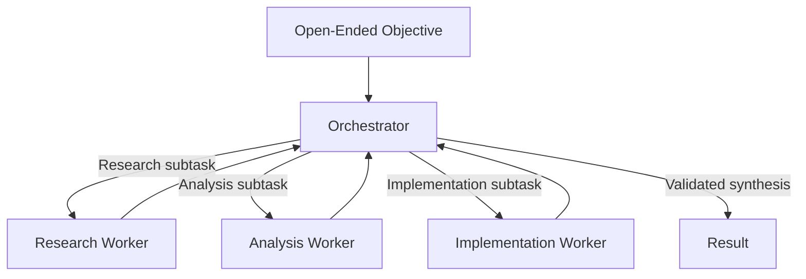

# Orchestrator-Workers Task Decomposition

## Pattern

Use an orchestrator to inspect an open-ended objective, create a bounded plan of semantically distinct subtasks, assign those subtasks to specialized workers, evaluate progress, and synthesize the final result.



The orchestrator owns decomposition and integration; workers own focused execution. Supply each worker only the context, tools, credentials, and output contract required for its subtask. Bound the number of rounds, assignments, replans, and workers. The orchestrator must report incomplete work when those limits are reached rather than silently claiming success.

Use dynamic model-based decomposition only when the plan cannot be derived reliably from structured state. If an existing status or type already determines the destination, dispatch with ordinary code instead of introducing a routing agent.

## Applicability

Use this pattern when:

- The required subtasks depend on the semantic content of the request.
- Different subtasks benefit from specialized instructions, tools, models, or context.
- The orchestrator must adapt the plan as workers discover new information.
- A single prompt would combine too many responsibilities or tools.
- Results require reconciliation or synthesis rather than simple concatenation.

Examples include repository-wide engineering changes, incident investigation, complex research, migration planning, and analysis that combines qualitative and quantitative evidence.

Avoid this pattern for small tasks, fixed pipelines, and deterministic routing. Dynamic orchestration adds inference calls, coordination latency, state management, and new failure modes. It also does not justify giving every worker access to every tool or sharing the entire conversation indiscriminately.

## Implementation

[Microsoft Agent Framework Magentic orchestration](https://learn.microsoft.com/en-us/agent-framework/workflows/orchestrations/magentic) provides a manager that plans work, delegates to participants, tracks progress, and replans when stalled. The following example creates separate research and analysis workers and applies explicit coordination limits:

```python
import os

from agent_framework import Agent
from agent_framework.foundry import FoundryChatClient
from agent_framework.orchestrations import MagenticBuilder
from azure.identity import AzureCliCredential

client = FoundryChatClient(
    project_endpoint=os.environ["FOUNDRY_PROJECT_ENDPOINT"],
    model=os.environ["FOUNDRY_MODEL"],
    credential=AzureCliCredential(),
)

researcher = Agent(
    name="researcher",
    description="Finds and cites authoritative technical evidence.",
    instructions=(
        "Research only the assigned question. Cite primary sources and "
        "identify evidence gaps. Do not propose implementation."
    ),
    client=client,
)

analyst = Agent(
    name="analyst",
    description="Compares evidence against explicit acceptance criteria.",
    instructions=(
        "Analyze supplied evidence. State assumptions and return structured "
        "findings. Do not perform new research."
    ),
    client=client,
)

manager = Agent(
    name="manager",
    description="Plans, delegates, and synthesizes bounded technical work.",
    instructions=(
        "Create only necessary subtasks. Delegate by worker capability, "
        "track unresolved requirements, and never claim missing work passed."
    ),
    client=client,
)

workflow = MagenticBuilder(
    participants=[researcher, analyst],
    manager_agent=manager,
    max_round_count=8,
    max_stall_count=2,
    max_reset_count=1,
).build()
```

The built-in limits constrain coordination but do not replace application-level budgets for tokens, elapsed time, tools, or spend. Validate the manager's final output against the original acceptance criteria. Preserve worker provenance so synthesis cannot erase which worker produced a claim or which source supports it.

The [Azure Architecture Center orchestration guidance](https://learn.microsoft.com/en-us/azure/architecture/ai-ml/guide/ai-agent-design-patterns) describes multi-agent orchestration as appropriate when specialization or separate security boundaries justify the added coordination. In production, isolate worker credentials, authorize each delegated action, prevent workers from recursively creating unbounded teams, and cancel outstanding work when the run terminates.

## References

- [Magentic orchestration — Microsoft Agent Framework](https://learn.microsoft.com/en-us/agent-framework/workflows/orchestrations/magentic)
- [Workflow orchestrations — Microsoft Agent Framework](https://learn.microsoft.com/en-us/agent-framework/workflows/orchestrations/)
- [AI Agent Orchestration Patterns — Azure Architecture Center](https://learn.microsoft.com/en-us/azure/architecture/ai-ml/guide/ai-agent-design-patterns)
