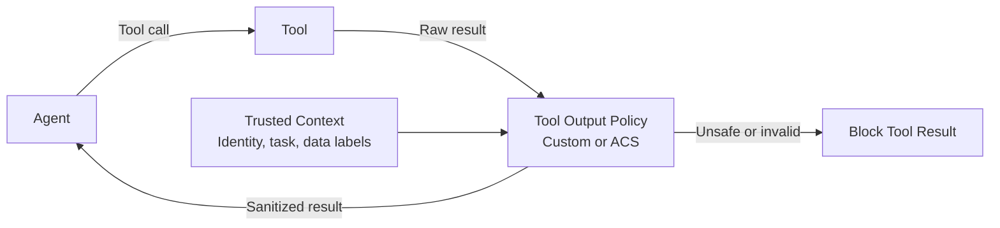

# Policy-Enforced Tool Output Transformation

## Pattern

Intercept each tool result before it returns to the agent, then apply only transformations permitted by explicit policy. The agent and model must receive the validated transformed result rather than the raw tool output.

Tool output can contain fields the agent does not need, including secrets, personal identifiers, internal metadata, or data from an overbroad upstream API. Removing or masking that data at the tool boundary prevents it from entering the model's context window, where it could influence generation, be disclosed in a later response, or appear in traces and conversation storage.



The policy enforcement point must run outside the model and on every result path, including successful, partial, cached, and error results. If transformation or validation fails, the host must block the result rather than pass the raw value through.

## Applicability

Use this pattern when a tool can return more data than an agent or model should receive, especially when:

- An upstream API returns sensitive fields alongside data required for the task.
- Tool results can contain secrets, personal data, regulated identifiers, or internal metadata.
- The permitted fields depend on the actor, tenant, task, or data classification.
- A structured result can be reduced to an explicit allowlist or safe projection.
- Unstructured result text contains values that have a reliable detection and masking rule.
- Multiple agent frameworks must apply the same centrally managed transformations.

Prefer changing the upstream API or tool contract so it never retrieves unnecessary data. Use transformation as defense in depth when the source cannot provide a least-data response or when policy depends on runtime context. Do not use transformation when removing data would make the result misleading or unsafe; block the result and return an explicit tool error instead.

## Implementation

### Introduction

The following implementations wrap a `get_customer_record` tool. Its upstream service returns a customer ID and case summary needed by the agent, but it can also return a Social Security number, payment card number, and internal risk score. Policy projects the raw result into a new object containing only `customer_id` and `summary`.

Field allowlisting is safer than deleting a known blocklist because newly added upstream fields remain excluded by default. For unstructured results, use a supported data-classification or data-loss-prevention service when pattern matching is insufficient. Version the policy and test malformed values, schema changes, nested fields, and adversarial formatting.

### Custom Tool Output Wrapper

A custom wrapper invokes the underlying tool, transforms its raw result, validates the safe projection, and returns only that projection to the agent.

=== "Python"

    ```python
    from collections.abc import Awaitable, Callable, Mapping
    from typing import TypedDict


    class CustomerRecordToolArgs(TypedDict):
        customer_id: str


    class SafeCustomerRecord(TypedDict):
        customer_id: str
        summary: str


    RawCustomerRecordTool = Callable[
        [CustomerRecordToolArgs],
        Awaitable[object],
    ]
    SafeCustomerRecordTool = Callable[
        [CustomerRecordToolArgs],
        Awaitable[SafeCustomerRecord],
    ]


    class ToolOutputPolicyError(Exception):
        pass


    def sanitize_customer_record(raw_result: object) -> SafeCustomerRecord:
        if not isinstance(raw_result, Mapping):
            raise ToolOutputPolicyError("Tool result is not an object.")

        customer_id = raw_result.get("customer_id")
        summary = raw_result.get("summary")
        if not isinstance(customer_id, str) or not isinstance(summary, str):
            raise ToolOutputPolicyError("Tool result has an invalid schema.")

        return {
            "customer_id": customer_id,
            "summary": summary,
        }


    def create_sanitized_customer_record_tool(
        invoke_raw_tool: RawCustomerRecordTool,
        audit: Callable[[str], None],
    ) -> SafeCustomerRecordTool:
        async def sanitized_tool(
            args: CustomerRecordToolArgs,
        ) -> SafeCustomerRecord:
            raw_result = await invoke_raw_tool(args)
            safe_result = sanitize_customer_record(raw_result)
            audit("customer_record_allowlist_applied")
            return safe_result

        return sanitized_tool
    ```

=== "TypeScript"

    ```typescript
    interface CustomerRecordToolArgs {
      customer_id: string;
    }

    interface SafeCustomerRecord {
      customer_id: string;
      summary: string;
    }

    type RawCustomerRecordTool = (
      args: CustomerRecordToolArgs,
    ) => Promise<unknown>;

    type SafeCustomerRecordTool = (
      args: CustomerRecordToolArgs,
    ) => Promise<SafeCustomerRecord>;

    class ToolOutputPolicyError extends Error {}

    function sanitizeCustomerRecord(rawResult: unknown): SafeCustomerRecord {
      if (typeof rawResult !== "object" || rawResult === null) {
        throw new ToolOutputPolicyError("Tool result is not an object.");
      }

      const record = rawResult as Record<string, unknown>;
      if (
        typeof record.customer_id !== "string" ||
        typeof record.summary !== "string"
      ) {
        throw new ToolOutputPolicyError("Tool result has an invalid schema.");
      }

      return {
        customer_id: record.customer_id,
        summary: record.summary,
      };
    }

    function createSanitizedCustomerRecordTool(
      invokeRawTool: RawCustomerRecordTool,
      audit: (reason: string) => void,
    ): SafeCustomerRecordTool {
      return async (args: CustomerRecordToolArgs): Promise<SafeCustomerRecord> => {
        const rawResult = await invokeRawTool(args);
        const safeResult = sanitizeCustomerRecord(rawResult);
        audit("customer_record_allowlist_applied");
        return safeResult;
      };
    }
    ```

Expose only the wrapped tool to the agent runtime:

=== "Python"

    ```python
    get_customer_record_tool = create_sanitized_customer_record_tool(
        get_customer_record_from_service,
        record_transformation,
    )

    tool_result = await get_customer_record_tool({
        "customer_id": "C-1042",
    })
    ```

=== "TypeScript"

    ```typescript
    const getCustomerRecordTool = createSanitizedCustomerRecordTool(
      getCustomerRecordFromService,
      recordTransformation,
    );

    const toolResult = await getCustomerRecordTool({
      customer_id: "C-1042",
    });
    ```

Keep `getCustomerRecordFromService` inaccessible to the agent-facing tool registry so no alternate path can return the raw object. If sanitation throws, report a failed tool call; do not return `rawResult` as a fallback. Audit reason codes and policy versions without copying the sensitive result into logs.

### Agent Control Specification

The [Agent Control Specification (ACS)](https://github.com/responsibleai/agent-control-spec) implements the [Agent Hooks](https://github.com/responsibleai/agent-hooks) interception contract. ACS can evaluate a policy at `post_tool_call`, after the host receives a concrete tool result but before that result returns to the agent. ACS proposes the replacement; the host remains responsible for validating, applying, and consuming it.

An ACS manifest projects the tool result into a [Rego](https://www.openpolicyagent.org/docs/policy-language) policy:

```yaml
agent_control_specification_version: "0.4.0-alpha.1"
metadata:
  name: customer-record-tool-output
policies:
  sanitize_customer_record:
    type: rego
    bundle: ./policy/sanitize-customer-record.rego
    query: data.customer_record.verdict
intervention_points:
  post_tool_call:
    policy_target: $.tool_result.value
    policy_target_kind: tool_result
    tool_name_from: $.tool_call.name
    policy:
      id: sanitize_customer_record
tools:
  get_customer_record:
    type: Tool
    id: get_customer_record
```

Pin the manifest version to one supported by the deployed prerelease package. The policy denies malformed or unexpected results by default and replaces a valid raw result with an allowlisted object:

```rego
package customer_record

import rego.v1

default verdict := {
    "decision": "deny",
    "reason": "invalid_customer_record_result",
}

raw_result := object.get(input.policy_target, "value", {})

verdict := {
    "decision": "transform",
    "reason": "customer_record_allowlist_applied",
    "transform": {
        "path": "$target",
        "value": {
            "customer_id": raw_result.customer_id,
            "summary": raw_result.summary,
        },
    },
} if {
    input.intervention_point == "post_tool_call"
    input.tool.id == "get_customer_record"
    is_string(raw_result.customer_id)
    is_string(raw_result.summary)
}
```

Install explicitly tested prerelease versions of the ACS and Agent Hooks packages:

```shell
python -m pip install --pre agent-control-spec
npm install @responsibleai/agent-control-spec@alpha
```

The host creates the interceptor once and emits each raw tool result before returning it to the agent:

=== "Python"

    ```python
    from collections.abc import Mapping
    from typing import TypeGuard

    from agent_control_spec import AcsInterceptor
    from agent_hooks import AgentContextBuilder, InterceptionEmitter

    emitter = InterceptionEmitter()
    emitter.register(
        AcsInterceptor("manifest.yaml"),
        "sanitize-customer-record",
    )

    context_builder = AgentContextBuilder(
        agent_id="customer-support-agent",
        framework="microsoft-agent-framework",
        session_id=session_id,
    )


    def is_safe_customer_record(
        value: object,
    ) -> TypeGuard[SafeCustomerRecord]:
        if not isinstance(value, Mapping):
            return False

        return (
            isinstance(value.get("customer_id"), str)
            and isinstance(value.get("summary"), str)
            and all(key in {"customer_id", "summary"} for key in value)
        )


    async def invoke_customer_record_tool(
        call_id: str,
        args: CustomerRecordToolArgs,
    ) -> SafeCustomerRecord:
        tool_args = {"customer_id": args["customer_id"]}
        raw_result = await get_customer_record_from_service(args)
        context = context_builder.post_tool_call(
            call_id=call_id,
            name="get_customer_record",
            args=tool_args,
            value=raw_result,
        )
        outcome = await emitter.emit(context)

        if not is_safe_customer_record(outcome.target):
            raise TypeError("Policy returned an invalid tool result.")

        return outcome.target
    ```

=== "TypeScript"

    ```typescript
    import { AcsInterceptor } from "@responsibleai/agent-control-spec";
    import {
      AgentContextBuilder,
      InterceptionEmitter,
      type JsonValue,
    } from "@responsibleai/agent-hooks";

    const emitter = new InterceptionEmitter();
    emitter.register(
      AcsInterceptor.fromPath("manifest.yaml"),
      "sanitize-customer-record",
    );

    const contextBuilder = new AgentContextBuilder({
      agentId: "customer-support-agent",
      framework: "microsoft-agent-framework",
      sessionId,
    });

    function isSafeCustomerRecord(
      value: unknown,
    ): value is SafeCustomerRecord {
      if (typeof value !== "object" || value === null) {
        return false;
      }

      const record = value as Record<string, unknown>;
      return (
        typeof record.customer_id === "string" &&
        typeof record.summary === "string" &&
        Object.keys(record).every(
          (key) => key === "customer_id" || key === "summary",
        )
      );
    }

    async function invokeCustomerRecordTool(
      callId: string,
      args: CustomerRecordToolArgs,
    ): Promise<SafeCustomerRecord> {
      const toolArgs: Record<string, JsonValue> = {
        customer_id: args.customer_id,
      };
      const rawResult: Record<string, JsonValue> =
        await getCustomerRecordFromService(args);
      const context = contextBuilder.postToolCall(
        callId,
        "get_customer_record",
        toolArgs,
        rawResult,
      );
      const outcome = await emitter.emit(context);

      if (!isSafeCustomerRecord(outcome.target)) {
        throw new TypeError("Policy returned an invalid tool result.");
      }

      return outcome.target;
    }
    ```

`emit` throws when policy denies the result or evaluation fails. On a transform verdict, Agent Hooks applies the replacement and returns the effective value as `outcome.target`. Returning `rawResult` instead would bypass policy and expose its sensitive fields to the agent. Do not catch an evaluation or validation error and return the original result.

Register this guarded handler as the tool exposed to a [Microsoft Agent Framework](https://learn.microsoft.com/en-us/agent-framework/overview/) agent. The framework must receive only the returned `SafeCustomerRecord`; keep the raw service response local to the guarded handler and out of prompts, traces, and conversation state.

## References

- [Agent Control Specification repository and runtime overview](https://github.com/responsibleai/agent-control-spec)
- [Agent Control Specification specification](https://github.com/responsibleai/agent-control-spec/blob/main/spec/SPECIFICATION.md)
- [Agent Control Specification Python SDK](https://github.com/responsibleai/agent-control-spec/tree/main/sdk/python)
- [Agent Control Specification Node wrapper](https://github.com/responsibleai/agent-control-spec/tree/main/sdk/node)
- [Agent Hooks specification and SDK overview](https://github.com/responsibleai/agent-hooks)
- [Rego policy language - Open Policy Agent](https://www.openpolicyagent.org/docs/policy-language)
- [Microsoft Agent Framework overview](https://learn.microsoft.com/en-us/agent-framework/overview/)
