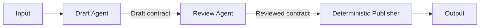

# Sequential Pipeline Orchestration

## Pattern

Arrange specialized agents or deterministic executors in a fixed sequence. Each stage receives the validated output of the preceding stage, performs one coherent responsibility, and passes a defined result to the next stage.



Define the order in application or workflow configuration rather than asking agents to choose the next stage. Give each boundary an explicit contract, validate before advancing, and stop with an attributable error when a stage fails. Persist checkpoints when a pipeline must resume without repeating completed side effects.

The pipeline may mix model-backed agents with ordinary code. Use an agent only for stages that require semantic interpretation or generation; use deterministic executors for schema validation, policy checks, state transitions, and other predictable work.

## Applicability

Use sequential orchestration when:

- The work has stable, linear dependencies.
- Each stage needs the preceding stage's result.
- Responsibilities benefit from separate prompts, tools, models, or security boundaries.
- Intermediate outputs can be validated or reviewed.
- Operators need a predictable execution trace.

Typical examples include draft-review-publish, extract-validate-enrich, translate-review-format, and plan-implement-verify pipelines.

Do not use a sequential pipeline when independent stages could run concurrently and latency matters, or when the required subtasks cannot be known until the work is inspected. Use [Orchestrator-Workers Task Decomposition](orchestrator-workers-task-decomposition.md) for genuinely dynamic decomposition. Avoid adding stages that merely forward data; each stage must contribute a distinct transformation or control.

## Implementation

[Microsoft Agent Framework sequential orchestration](https://learn.microsoft.com/en-us/agent-framework/workflows/orchestrations/sequential) runs participants in a defined order and passes the conversation history through the pipeline. The following example separates drafting from review:

=== "Python"

    ```python
    import os

    from agent_framework.foundry import FoundryChatClient
    from agent_framework.orchestrations import SequentialBuilder
    from azure.identity import AzureCliCredential

    client = FoundryChatClient(
        project_endpoint=os.environ["FOUNDRY_PROJECT_ENDPOINT"],
        model=os.environ["FOUNDRY_MODEL"],
        credential=AzureCliCredential(),
    )

    writer = client.as_agent(
        name="writer",
        instructions=(
            "Draft one release note from the supplied change record. "
            "Do not invent behavior or validation results."
        ),
    )

    reviewer = client.as_agent(
        name="reviewer",
        instructions=(
            "Review the draft against the supplied change record. "
            "Return a corrected release note and list any unsupported claims."
        ),
    )

    workflow = SequentialBuilder(
        participants=[writer, reviewer],
    ).build()

    events = await workflow.run(
        "Change: add tenant-scoped export with audit logging."
    )
    outputs = events.get_outputs()
    ```

=== "TypeScript"

    ```typescript
    interface AgentOptions {
      name: string;
      instructions: string;
    }

    interface Agent {}

    interface WorkflowEvents {
      getOutputs(): readonly unknown[];
    }

    interface SequentialWorkflow {
      run(input: string): Promise<WorkflowEvents>;
    }

    interface AgentRuntime {
      createAgent(options: AgentOptions): Agent;
      createSequentialWorkflow(
        participants: readonly Agent[],
      ): SequentialWorkflow;
    }

    declare const runtime: AgentRuntime;

    const writer = runtime.createAgent({
      name: "writer",
      instructions:
        "Draft one release note from the supplied change record. " +
        "Do not invent behavior or validation results.",
    });

    const reviewer = runtime.createAgent({
      name: "reviewer",
      instructions:
        "Review the draft against the supplied change record. " +
        "Return a corrected release note and list any unsupported claims.",
    });

    const workflow = runtime.createSequentialWorkflow([writer, reviewer]);

    const events = await workflow.run(
      "Change: add tenant-scoped export with audit logging.",
    );
    const outputs = events.getOutputs();
    ```

Treat the last agent response as a candidate result, not an automatic publication command. Validate its schema and required evidence in deterministic code before invoking a side-effecting publisher. If review must sometimes return work to the writer, model that bounded revision loop explicitly rather than hiding retries inside either prompt.

The [Azure Architecture Center orchestration guidance](https://learn.microsoft.com/en-us/azure/architecture/ai-ml/guide/ai-agent-design-patterns) recommends sequential orchestration for clear linear dependencies and progressive refinement. It also identifies important boundaries: pipelines are a poor fit for dynamic collaboration, backtracking, or independent work that should execute concurrently.

For production operation, record the stage name, input version, output version, model configuration, validation result, elapsed time, and correlation ID. Apply authorization and data-minimization rules at every stage because a downstream participant may have a different trust boundary from the participant that produced its input.

## References

- [Sequential orchestration — Microsoft Agent Framework](https://learn.microsoft.com/en-us/agent-framework/workflows/orchestrations/sequential)
- [Workflow orchestrations — Microsoft Agent Framework](https://learn.microsoft.com/en-us/agent-framework/workflows/orchestrations/)
- [AI Agent Orchestration Patterns — Azure Architecture Center](https://learn.microsoft.com/en-us/azure/architecture/ai-ml/guide/ai-agent-design-patterns)
