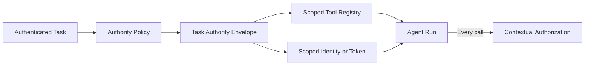

# Task-Scoped Agent Authority

## Pattern

Create an explicit authority envelope for every agent run. The envelope identifies the initiating actor, approved task type, tenant, resource scope, available tools, allowed operations, credential audience, expiration, and any approval requirements. Expose only capabilities inside that envelope and revoke them when the run ends.



The host, not the model, constructs the envelope from trusted identity and application state. Tool descriptions can tell the model what is available, but the registry and downstream services must enforce the actual boundary. A model request cannot add a tool, widen a resource scope, extend expiry, or exchange the run credential for broader authority.

## Applicability

Use this pattern whenever an agent can access protected data or produce side effects, especially when:

- One agent definition serves multiple task types or tenants.
- Some tools are necessary only for privileged workflows.
- Credentials would otherwise be shared across unrelated runs.
- A child agent or worker needs less authority than its parent.
- Access should expire with a task, approval, or incident.

Create separate envelopes and identities for independently accountable workers. Delegation should attenuate authority: a child can receive a subset of the parent's capability, never silently inherit or expand all of it.

This pattern scopes the run's maximum authority. [Contextual Tool Authorization](contextual-tool-authorization.md) still evaluates each proposed call and its arguments. A human approval gate still applies to high-impact actions inside the envelope.

## Implementation

[Microsoft Entra Agent ID architecture](https://learn.microsoft.com/en-us/entra/agent-id/how-to-plan-agent-identity-architecture) recommends one identity per logical agent by default, which provides separate audit trails, access control, sponsorship, and lifecycle management. [Azure RBAC best practices](https://learn.microsoft.com/en-us/azure/role-based-access-control/best-practices) recommend granting only required actions at the narrowest practical scope and using time-bound privileged access.

First, connect the agent to [Microsoft Agent 365](https://learn.microsoft.com/en-us/microsoft-agent-365/developer/get-started). The standard registration path creates an agent identity blueprint and an agent identity, then writes the generated identifiers and endpoints to `a365.generated.config.json`. Treat that generated registration as lifecycle configuration, not as permission to expose every tool to every run.

The application loads the registered identity into an agent record. `allowedTaskKinds` is the agent's maximum capability boundary; it is narrower than all capabilities available to the hosting project.

=== "Python"

    ```python
    from dataclasses import dataclass
    from datetime import datetime, timezone
    from typing import Literal

    TaskKind = Literal["case-review", "refund-review"]
    ToolName = Literal[
        "get_case",
        "get_payment",
        "draft_response",
        "request_refund",
    ]


    @dataclass(frozen=True)
    class AgentRecord:
        agent_identity_id: str
        display_name: str
        allowed_task_kinds: frozenset[TaskKind]


    @dataclass(frozen=True)
    class TaskAuthority:
        authority_id: str
        agent_identity_id: str
        actor_id: str
        tenant_id: str
        task_kind: TaskKind
        case_id: str
        tools: frozenset[ToolName]
        expires_at: datetime


    @dataclass(frozen=True)
    class ResolvedTask:
        authority_id: str
        actor_id: str
        tenant_id: str
        task_kind: TaskKind
        case_id: str
        expires_at: datetime


    tools_by_task: dict[TaskKind, tuple[ToolName, ...]] = {
        "case-review": ("get_case", "draft_response"),
        "refund-review": (
            "get_case",
            "get_payment",
            "draft_response",
            "request_refund",
        ),
    }


    def create_authority(
        agent: AgentRecord,
        task: ResolvedTask,
    ) -> TaskAuthority:
        if task.task_kind not in agent.allowed_task_kinds:
            raise PermissionError(
                "This agent is not authorized for the task kind."
            )
        if task.expires_at <= datetime.now(timezone.utc):
            raise PermissionError("Task authority has already expired.")

        return TaskAuthority(
            authority_id=task.authority_id,
            agent_identity_id=agent.agent_identity_id,
            actor_id=task.actor_id,
            tenant_id=task.tenant_id,
            task_kind=task.task_kind,
            case_id=task.case_id,
            tools=frozenset(tools_by_task[task.task_kind]),
            expires_at=task.expires_at,
        )
    ```

=== "TypeScript"

    ```typescript
    type TaskKind = "case-review" | "refund-review";
    type ToolName =
      | "get_case"
      | "get_payment"
      | "draft_response"
      | "request_refund";

    interface AgentRecord {
      agentIdentityId: string;
      displayName: string;
      allowedTaskKinds: ReadonlySet<TaskKind>;
    }

    interface TaskAuthority {
      authorityId: string;
      agentIdentityId: string;
      actorId: string;
      tenantId: string;
      taskKind: TaskKind;
      caseId: string;
      tools: ReadonlySet<ToolName>;
      expiresAt: Date;
    }

    interface ResolvedTask {
      authorityId: string;
      actorId: string;
      tenantId: string;
      taskKind: TaskKind;
      caseId: string;
      expiresAt: Date;
    }

    const toolsByTask: Record<TaskKind, readonly ToolName[]> = {
      "case-review": ["get_case", "draft_response"],
      "refund-review": [
        "get_case",
        "get_payment",
        "draft_response",
        "request_refund",
      ],
    };

    function createAuthority(
      agent: AgentRecord,
      task: ResolvedTask,
    ): TaskAuthority {
      if (!agent.allowedTaskKinds.has(task.taskKind)) {
        throw new Error("This agent is not authorized for the task kind.");
      }
      if (task.expiresAt.getTime() <= Date.now()) {
        throw new Error("Task authority has already expired.");
      }

      return {
        ...task,
        agentIdentityId: agent.agentIdentityId,
        tools: new Set(toolsByTask[task.taskKind]),
      };
    }
    ```

Every registered tool remains behind a runtime authorization wrapper. Filtering the registry helps the model select only relevant tools, while the wrapper provides the enforceable boundary:

=== "Python"

    ```python
    from datetime import datetime, timezone
    from typing import Protocol


    class AgentTool(Protocol):
        name: ToolName

        async def invoke(
            self,
            args: object,
            authority: TaskAuthority,
        ) -> object: ...


    class ScopedAgentTool:
        def __init__(
            self,
            name: ToolName,
            tool: AgentTool,
            authority: TaskAuthority,
        ) -> None:
            self.name = name
            self._tool = tool
            self._authority = authority

        async def invoke(self, args: object) -> object:
            if self._authority.expires_at <= datetime.now(timezone.utc):
                raise PermissionError("Task authority has expired.")

            await tool_policy.assert_allowed(
                authority=self._authority,
                tool_name=self.name,
                arguments=args,
            )

            return await self._tool.invoke(args, self._authority)


    def build_scoped_tools(
        authority: TaskAuthority,
        all_tools: dict[ToolName, AgentTool],
    ) -> list[ScopedAgentTool]:
        scoped_tools: list[ScopedAgentTool] = []
        for name in authority.tools:
            tool = all_tools.get(name)
            if tool is None:
                raise RuntimeError(
                    f"Required tool is not registered: {name}"
                )
            scoped_tools.append(ScopedAgentTool(name, tool, authority))

        return scoped_tools
    ```

=== "TypeScript"

    ```typescript
    interface AgentTool {
      name: ToolName;
      invoke(
        args: unknown,
        authority: TaskAuthority,
      ): Promise<unknown>;
    }

    function buildScopedTools(
      authority: TaskAuthority,
      allTools: ReadonlyMap<ToolName, AgentTool>,
    ): AgentTool[] {
      return [...authority.tools].map((name) => {
        const tool = allTools.get(name);
        if (!tool) {
          throw new Error(`Required tool is not registered: ${name}`);
        }

        return {
          name,
          invoke: async (args: unknown): Promise<unknown> => {
            if (authority.expiresAt.getTime() <= Date.now()) {
              throw new Error("Task authority has expired.");
            }

            await toolPolicy.assertAllowed({
              authority,
              toolName: name,
              arguments: args,
            });

            return tool.invoke(args, authority);
          },
        };
      });
    }
    ```

The [Agent 365 Notifications module](https://learn.microsoft.com/en-us/microsoft-agent-365/developer/notification) and Microsoft 365 Agents SDK expose installation and lifecycle activities. The host can use an installation `add` event to send an [Adaptive Card](https://learn.microsoft.com/en-us/microsoft-365/agents-sdk/adaptive-cards) that makes the new agent's baseline authority visible. The card deliberately reports that no task tools are active yet:

=== "Python"

    ```python
    from typing import Any


    def creation_card(agent: AgentRecord) -> dict[str, Any]:
        return {
            "type": "message",
            "attachments": [{
                "contentType": "application/vnd.microsoft.card.adaptive",
                "content": {
                    "type": "AdaptiveCard",
                    "version": "1.5",
                    "body": [
                        {
                            "type": "TextBlock",
                            "text": f"{agent.display_name} is registered",
                            "weight": "Bolder",
                            "size": "Medium",
                        },
                        {
                            "type": "FactSet",
                            "facts": [
                                {
                                    "title": "Agent identity",
                                    "value": agent.agent_identity_id,
                                },
                                {
                                    "title": "Allowed task kinds",
                                    "value": ", ".join(
                                        sorted(agent.allowed_task_kinds)
                                    ),
                                },
                                {
                                    "title": "Active task tools",
                                    "value": (
                                        "None until a task authority is issued"
                                    ),
                                },
                            ],
                        },
                    ],
                },
            }],
        }
    ```

=== "TypeScript"

    ```typescript
    import {
      ActivityTypes,
      type Activity,
    } from "@microsoft/agents-activity";
    import {
      AgentApplication,
      MemoryStorage,
      type TurnContext,
      type TurnState,
    } from "@microsoft/agents-hosting";

    function creationCard(agent: AgentRecord): Activity {
      return {
        type: ActivityTypes.Message,
        attachments: [{
          contentType: "application/vnd.microsoft.card.adaptive",
          content: {
            type: "AdaptiveCard",
            version: "1.5",
            body: [
              {
                type: "TextBlock",
                text: `${agent.displayName} is registered`,
                weight: "Bolder",
                size: "Medium",
              },
              {
                type: "FactSet",
                facts: [
                  {
                    title: "Agent identity",
                    value: agent.agentIdentityId,
                  },
                  {
                    title: "Allowed task kinds",
                    value: [...agent.allowedTaskKinds].join(", "),
                  },
                  {
                    title: "Active task tools",
                    value: "None until a task authority is issued",
                  },
                ],
              },
            ],
          },
        }],
      };
    }
    ```

The same host resolves each incoming request from authenticated application state, creates the task authority, and constructs the model-facing tool registry only for that run:

=== "Python"

    ```python
    from collections.abc import Awaitable, Callable
    from typing import Protocol


    class TurnContext(Protocol):
        activity: object

        async def send_activity(self, activity: object) -> None: ...


    class ActivityHost(Protocol):
        def on_activity(
            self,
            activity_type: str,
            handler: Callable[[TurnContext], Awaitable[None]],
        ) -> None: ...


    class ScopedSupportAgent:
        def __init__(
            self,
            host: ActivityHost,
            agent_record: AgentRecord,
            task_resolver,
            tool_registry: dict[ToolName, AgentTool],
            agent_factory,
        ) -> None:
            self.agent_record = agent_record
            self.task_resolver = task_resolver
            self.tool_registry = tool_registry
            self.agent_factory = agent_factory
            host.on_activity(
                "installationUpdate",
                self.handle_installation,
            )
            host.on_activity("message", self.handle_message)

        async def handle_installation(
            self,
            context: TurnContext,
        ) -> None:
            if context.activity.action == "add":
                await context.send_activity(
                    creation_card(self.agent_record)
                )

        async def handle_message(
            self,
            context: TurnContext,
        ) -> None:
            task = await self.task_resolver.resolve(context)
            authority = create_authority(self.agent_record, task)
            tools = build_scoped_tools(
                authority,
                self.tool_registry,
            )

            worker = self.agent_factory.create(
                agent_identity_id=authority.agent_identity_id,
                tools=tools,
            )

            result = await worker.run(context.activity.text or "")
            await context.send_activity(result.text)
    ```

=== "TypeScript"

    ```typescript
    class ScopedSupportAgent extends AgentApplication<TurnState> {
      constructor(
        private readonly agentRecord: AgentRecord,
        private readonly taskResolver: TaskResolver,
        private readonly toolRegistry: ReadonlyMap<ToolName, AgentTool>,
        private readonly agentFactory: AgentFactory,
      ) {
        super({
          storage: new MemoryStorage(),
          authorization: {
            agentic: { type: "agentic" },
          },
        });

        this.onActivity(
          ActivityTypes.InstallationUpdate,
          async (context) => this.handleInstallation(context),
        );
        this.onActivity(
          ActivityTypes.Message,
          async (context) => this.handleMessage(context),
        );
      }

      private async handleInstallation(
        context: TurnContext,
      ): Promise<void> {
        if (context.activity.action === "add") {
          await context.sendActivity(creationCard(this.agentRecord));
        }
      }

      private async handleMessage(
        context: TurnContext,
      ): Promise<void> {
        const task = await this.taskResolver.resolve(context);
        const authority = createAuthority(this.agentRecord, task);
        const tools = buildScopedTools(authority, this.toolRegistry);

        const worker = this.agentFactory.create({
          agentIdentityId: authority.agentIdentityId,
          tools,
        });

        const result = await worker.run(context.activity.text ?? "");
        await context.sendActivity(result.text);
      }
    }
    ```

`TaskResolver.resolve` must authenticate the actor and load the tenant, case, task kind, and expiry from trusted application state. It must not accept those authority fields from model-generated arguments. `AgentFactory` can create a [Microsoft Agent Framework](https://learn.microsoft.com/en-us/agent-framework/overview/) agent or another model runtime, but it receives only the scoped tools and the registered agent identity.

Acquire tokens for the agent identity and resource audience required by the selected tools; do not place a broad reusable secret in the prompt, memory, or tool arguments. Record the authority-envelope identifier in tool telemetry so operators can reconstruct which grant permitted an action. On cancellation or completion, dispose run-scoped clients, revoke temporary grants where supported, and prevent resumed runs from using an expired envelope.

Agent 365 also defines `agenticUserIdentityCreated`, `agenticUserWorkloadOnboardingUpdated`, and `agenticUserDeleted` lifecycle notifications for an agent's optional user identity. Use those events to initialize or clean up user-specific resources such as a mailbox. They do not replace task authorization and must not automatically activate tools or grant resource access.

Organizations can implement the identity boundary through [Microsoft Agent 365 identity](https://learn.microsoft.com/en-us/microsoft-agent-365/developer/identity), [Microsoft Foundry agent identities](https://learn.microsoft.com/en-us/azure/foundry/agents/concepts/agent-identity), direct Entra Agent ID integration, dedicated managed or workload identities, or delegated on-behalf-of identity for user-scoped work. Agent 365 adds centralized inventory and governance, but it is not required to apply the pattern.

Avoid using one Foundry project managed identity across logical agents that require different permissions or audit boundaries. Sharing is reasonable only when the agents intentionally occupy the same trust boundary and need the same authority. Identity isolation alone is also insufficient: continue to reduce the registered tools and authorize every call from its task context.

## References

- [Plan your agent identity architecture — Microsoft Entra Agent ID](https://learn.microsoft.com/en-us/entra/agent-id/how-to-plan-agent-identity-architecture)
- [Connect an existing agent to Microsoft Agent 365](https://learn.microsoft.com/en-us/microsoft-agent-365/developer/get-started)
- [Agent 365 identity](https://learn.microsoft.com/en-us/microsoft-agent-365/developer/identity)
- [Notify agents — Microsoft Agent 365](https://learn.microsoft.com/en-us/microsoft-agent-365/developer/notification)
- [Use adaptive cards in agents — Microsoft 365 Agents SDK](https://learn.microsoft.com/en-us/microsoft-365/agents-sdk/adaptive-cards)
- [Agent identity concepts in Microsoft Foundry](https://learn.microsoft.com/en-us/azure/foundry/agents/concepts/agent-identity)
- [Best practices for Azure RBAC](https://learn.microsoft.com/en-us/azure/role-based-access-control/best-practices)
- [Microsoft Agent Framework overview](https://learn.microsoft.com/en-us/agent-framework/overview/)
