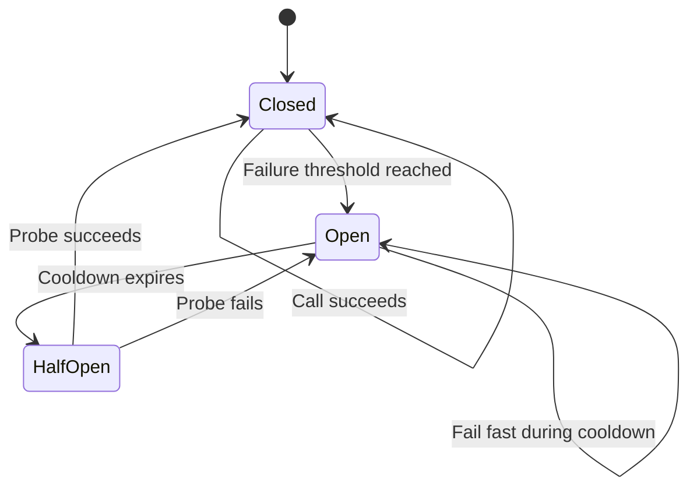

# Tool Call Circuit Breaker

## Pattern

Place a circuit breaker at the boundary between an agent tool and each remote dependency whose failures can persist across calls. The breaker records qualifying dependency failures and moves through three states:

- **Closed:** Calls reach the dependency. Consecutive qualifying failures count toward a threshold.
- **Open:** Calls fail immediately without contacting the dependency.
- **Half-open:** After a cooldown, one controlled probe call determines whether the dependency has recovered.



Maintain a separate breaker for each independently failing tool or backend. When a circuit is open, return an explicit temporary-unavailability result that the agent can report or use to select an approved fallback. Do not let the model repeatedly probe the dependency or fabricate a successful result.

Unlike [Contextual Tool Authorization](contextual-tool-authorization.md), which decides whether a call is permitted, or [Bounded Tool Calls](bounded-tool-calls.md), which caps per-run call volume, this pattern suppresses calls based on dependency health across operations.

## Applicability

Use this pattern when an agent tool calls a remote service that can remain degraded across multiple requests, especially when:

- Many agent runs share the same dependency.
- Repeated calls would amplify load during an outage.
- Calls consume model tokens, service quotas, or metered capacity.
- Other tools can still complete useful work while one dependency recovers.
- The application can classify which failures indicate dependency health.

Count failures such as connection errors, timeouts, and selected service-unavailable responses. Do not trip the circuit for invalid tool arguments, denied authorization, policy rejection, or other caller-specific failures that do not indicate an unhealthy dependency.

A circuit breaker complements but does not replace bounded retries and tool-call budgets. A retry policy governs a small number of attempts for one operation. A tool-call budget limits total work during one agent run. A circuit breaker suppresses calls across operations while a dependency is likely to remain unhealthy.

Choose thresholds and cooldowns from the dependency's latency, recovery behavior, and service objectives. For horizontally scaled applications, use a gateway or shared state when every instance must observe the same circuit; an in-memory breaker protects only one process.

## Implementation

The [Azure Architecture Center circuit-breaker guidance](https://learn.microsoft.com/en-us/azure/architecture/patterns/circuit-breaker) defines the closed, open, and half-open state transitions. The following abstractions apply those transitions around a tool handler. They permit only one half-open probe and count only failures classified as dependency-health signals.

=== "Python"

    ```python
    import time
    from collections.abc import Awaitable, Callable
    from typing import Literal, TypeVar

    CircuitState = Literal["closed", "open", "half-open"]
    AttemptKind = Literal["normal", "probe"]
    T = TypeVar("T")


    class ToolCircuitOpenError(Exception):
        def __init__(self, tool_name: str, retry_after_ms: float) -> None:
            self.tool_name = tool_name
            self.retry_after_ms = retry_after_ms
            message = (
                f"{tool_name} is unavailable; retry after {retry_after_ms} ms."
                if retry_after_ms > 0
                else (
                    f"{tool_name} is unavailable; "
                    "a recovery probe is already running."
                )
            )
            super().__init__(message)


    class ToolCircuitBreaker:
        def __init__(
            self,
            tool_name: str,
            *,
            failure_threshold: int,
            open_duration_ms: float,
            should_count_failure: Callable[[BaseException], bool],
            now: Callable[[], float] | None = None,
        ) -> None:
            if (
                isinstance(failure_threshold, bool)
                or not isinstance(failure_threshold, int)
                or failure_threshold < 1
            ):
                raise ValueError("failure_threshold must be a positive integer.")
            if open_duration_ms <= 0:
                raise ValueError("open_duration_ms must be greater than zero.")

            self._tool_name = tool_name
            self._failure_threshold = failure_threshold
            self._open_duration_ms = open_duration_ms
            self._should_count_failure = should_count_failure
            self._now = now or (lambda: time.monotonic() * 1000)
            self._state: CircuitState = "closed"
            self._failures = 0
            self._opened_at = 0.0
            self._probe_in_flight = False

        async def execute(self, operation: Callable[[], Awaitable[T]]) -> T:
            attempt = self._start_attempt()

            try:
                result = await operation()
                self._record_success(attempt)
                return result
            except BaseException as error:
                self._record_failure(attempt, error)
                raise
            finally:
                if attempt == "probe" and self._state == "half-open":
                    self._probe_in_flight = False

        @property
        def current_state(self) -> CircuitState:
            return self._state

        def _start_attempt(self) -> AttemptKind:
            if self._state == "open":
                retry_after_ms = (
                    self._opened_at + self._open_duration_ms - self._now()
                )

                if retry_after_ms > 0:
                    raise ToolCircuitOpenError(
                        self._tool_name,
                        retry_after_ms,
                    )

                self._state = "half-open"

            if self._state == "half-open":
                if self._probe_in_flight:
                    raise ToolCircuitOpenError(self._tool_name, 0)

                self._probe_in_flight = True
                return "probe"

            return "normal"

        def _record_success(self, attempt: AttemptKind) -> None:
            if attempt == "probe":
                self._state = "closed"
                self._failures = 0
                self._probe_in_flight = False
            elif self._state == "closed":
                self._failures = 0

        def _record_failure(
            self,
            attempt: AttemptKind,
            error: BaseException,
        ) -> None:
            if not self._should_count_failure(error):
                return

            if attempt == "probe":
                self._open_circuit()
                return

            if self._state != "closed":
                return

            self._failures += 1
            if self._failures >= self._failure_threshold:
                self._open_circuit()

        def _open_circuit(self) -> None:
            self._state = "open"
            self._opened_at = self._now()
            self._failures = 0
            self._probe_in_flight = False
    ```

=== "TypeScript"

    ```typescript
    type CircuitState = "closed" | "open" | "half-open";
    type AttemptKind = "normal" | "probe";

    interface CircuitBreakerOptions {
      failureThreshold: number;
      openDurationMs: number;
      shouldCountFailure: (error: unknown) => boolean;
      now?: () => number;
    }

    class ToolCircuitOpenError extends Error {
      constructor(
        readonly toolName: string,
        readonly retryAfterMs: number,
      ) {
        super(
          retryAfterMs > 0
            ? `${toolName} is unavailable; retry after ${retryAfterMs} ms.`
            : `${toolName} is unavailable; a recovery probe is already running.`,
        );
      }
    }

    class ToolCircuitBreaker {
      private state: CircuitState = "closed";
      private failures = 0;
      private openedAt = 0;
      private probeInFlight = false;
      private readonly now: () => number;

      constructor(
        private readonly toolName: string,
        private readonly options: CircuitBreakerOptions,
      ) {
        if (
          !Number.isInteger(options.failureThreshold) ||
          options.failureThreshold < 1
        ) {
          throw new RangeError("failureThreshold must be a positive integer.");
        }
        if (options.openDurationMs <= 0) {
          throw new RangeError("openDurationMs must be greater than zero.");
        }

        this.now = options.now ?? Date.now;
      }

      async execute<T>(operation: () => Promise<T>): Promise<T> {
        const attempt = this.startAttempt();

        try {
          const result = await operation();
          this.recordSuccess(attempt);
          return result;
        } catch (error) {
          this.recordFailure(attempt, error);
          throw error;
        } finally {
          if (attempt === "probe" && this.state === "half-open") {
            this.probeInFlight = false;
          }
        }
      }

      get currentState(): CircuitState {
        return this.state;
      }

      private startAttempt(): AttemptKind {
        if (this.state === "open") {
          const retryAfterMs =
            this.openedAt + this.options.openDurationMs - this.now();

          if (retryAfterMs > 0) {
            throw new ToolCircuitOpenError(this.toolName, retryAfterMs);
          }

          this.state = "half-open";
        }

        if (this.state === "half-open") {
          if (this.probeInFlight) {
            throw new ToolCircuitOpenError(this.toolName, 0);
          }

          this.probeInFlight = true;
          return "probe";
        }

        return "normal";
      }

      private recordSuccess(attempt: AttemptKind): void {
        if (attempt === "probe") {
          this.state = "closed";
          this.failures = 0;
          this.probeInFlight = false;
        } else if (this.state === "closed") {
          this.failures = 0;
        }
      }

      private recordFailure(attempt: AttemptKind, error: unknown): void {
        if (!this.options.shouldCountFailure(error)) {
          return;
        }

        if (attempt === "probe") {
          this.openCircuit();
          return;
        }

        if (this.state !== "closed") {
          return;
        }

        this.failures += 1;
        if (this.failures >= this.options.failureThreshold) {
          this.openCircuit();
        }
      }

      private openCircuit(): void {
        this.state = "open";
        this.openedAt = this.now();
        this.failures = 0;
        this.probeInFlight = false;
      }
    }
    ```

Create one breaker for the inventory dependency and wrap the handler before exposing it as a tool:

=== "Python"

    ```python
    from typing import Protocol


    class InventoryService(Protocol):
        async def available_units(self, sku: str) -> int: ...


    class DependencyUnavailableError(Exception):
        pass


    inventory_breaker = ToolCircuitBreaker(
        "get_inventory",
        failure_threshold=5,
        open_duration_ms=30_000,
        should_count_failure=lambda error: isinstance(
            error,
            DependencyUnavailableError,
        ),
    )


    async def get_inventory(sku: str) -> int:
        return await inventory_breaker.execute(
            lambda: inventory_service.available_units(sku)
        )
    ```

=== "TypeScript"

    ```typescript
    interface InventoryService {
      availableUnits(sku: string): Promise<number>;
    }

    declare const inventoryService: InventoryService;

    class DependencyUnavailableError extends Error {}

    const inventoryBreaker = new ToolCircuitBreaker("get_inventory", {
      failureThreshold: 5,
      openDurationMs: 30_000,
      shouldCountFailure: (error) =>
        error instanceof DependencyUnavailableError,
    });

    async function getInventory(sku: string): Promise<number> {
      return inventoryBreaker.execute(() =>
        inventoryService.availableUnits(sku),
      );
    }
    ```

The service client should translate connection failures, timeouts, and selected transient responses into `DependencyUnavailableError`. Input and authorization failures pass through without changing circuit health.

Register the wrapped `getInventory` handler as a function tool with [Microsoft Agent Framework](https://learn.microsoft.com/en-us/agent-framework/overview/) or a [Microsoft Foundry prompt agent](https://learn.microsoft.com/en-us/azure/foundry/agents/how-to/tools/function-calling). Translate `ToolCircuitOpenError` into a structured tool failure that identifies temporary unavailability and the remaining cooldown. The agent may use another approved source or report the limitation, but it should not retry before the circuit permits a probe.

In a distributed deployment, place equivalent circuit-breaking behavior in a shared service layer or gateway when instances must coordinate dependency health. Keep tool-level telemetry for state transitions, rejected calls, probes, and recovery so operators can distinguish an open circuit from a model or tool-selection failure.

## References

- [Circuit Breaker pattern — Azure Architecture Center](https://learn.microsoft.com/en-us/azure/architecture/patterns/circuit-breaker)
- [Retry pattern — Azure Architecture Center](https://learn.microsoft.com/en-us/azure/architecture/patterns/retry)
- [Transient fault handling — Azure Architecture Center](https://learn.microsoft.com/en-us/azure/architecture/best-practices/transient-faults)
- [Microsoft Agent Framework overview](https://learn.microsoft.com/en-us/agent-framework/overview/)
- [Use function calling with Microsoft Foundry agents](https://learn.microsoft.com/en-us/azure/foundry/agents/how-to/tools/function-calling)
